# 🧪 Homelab Engineering Lab Notebook

Welcome to the lab repository. This vault tracks all architecture experiments, failure logs, knowledge base articles, and operational runbooks across our homelab infrastructure.

---

## 🧭 Navigation & Core Indexes

- 🧰 **Hardware & Assets Inventory:** [inventory](inventory.md) (Physical nodes, microcontrollers, cloud accounts, domain, and running services)
- 📊 **Resource Planning & Hypervisor Constraints:** [resource-planning-and-limits](knowledge/resource-planning-and-limits.md) (RAM budgeting, LXC vs VM overhead, KSM deduplication, Debian 13 host parity)
- 💡 **Future Roadmap & Tech Backlog:** [future-roadmap](knowledge/future-roadmap.md) (Gitea, Headscale, NAS, Immich, Pi-hole, IPv6/DDNS, Arr stack, Kiwix, Home Assistant, Asterisk/VoIP)
- 📐 **Architecture Decisions (ADR):** [architecture-decisions](knowledge/architecture-decisions.md) (Permanent logs of network topologies, bridge designs, and security models)
- ⚠️ **Common Troubles & Quirks:** [common-troubles](knowledge/common-troubles.md) (Hardware crash recovery, driver workarounds)
- 🧠 **Mistakes to Avoid (Lessons Learned):** [mistakes-to-avoid](knowledge/mistakes-to-avoid.md)
- 🔧 **Troubleshooting Playbook:** [troubleshooting-playbook](knowledge/troubleshooting-playbook.md)
- 🤖 **Infrastructure-as-Code (IaC) Framework:** [iac-framework](iac/README.md) (Agentless pyinfra & POSIX playbooks for Proxmox hardening, WAN controller, OpenWrt, and Pi-hole)
- 📝 **New Experiment Template:** [experiment-template](templates/experiment-template.md)

> [!IMPORTANT]
> **Universal Service Granularity Standard:**  
> Every individual service, engine, or subsystem—regardless of scale or complexity (e.g. `00-proxmox-host`, `01-dual-openwrt-routing`, `03-vaultwarden-service`, `07-pihole-dns-sinkhole`, and future services like Gitea, n8n, Home Assistant, Immich, etc.)—**MUST maintain its own dedicated project directory** under `projects/XX-<service-name>/`.
> - Each project folder contains its own self-contained `README.md` (architecture, specs, dependencies), operational `runbook.md`, configuration templates, and experiment logs.
> - Inter-service relationships, hypervisor hosting (`00-proxmox-host`), and router firewall rules (`01-dual-openwrt-routing`) maintain explicit cross-links to the component's dedicated project directory.

---

## 🗺️ Master Network & Service Architecture

```mermaid
flowchart TD
    %% ==================================================
    %% 1. Physical Network and WAN
    %% ==================================================
    subgraph PhysicalWAN["Physical Network & WAN"]
        ISP["ISP"] --> ONU["ONU"]
        ONU --> Router{"Physical Router<br/>OpenWrt Archer C6"}

        Router -->|Whole-Home Default Restrictions / Parental Control| Repeater["Wi-Fi Repeater"]
        Repeater --> Dad["Dad's Phone (Restricted)"]
        Repeater --> Mom["Mom's Phone (Restricted)"]

        Router -->|MAC Allowlist / Unrestricted| MyPhone["My Phone"]
        Router -->|Wired LAN / Unrestricted| PC["HP EliteDesk PC"]

        Router -->|Dedicated 2.4GHz Low-TX SSID<br/>MAC Allowlist + L2 Isolation| IoT_WiFi["Isolated IoT Wi-Fi<br/>snowfox-iot"]
        IoT_WiFi --> ESP32["ESP32 Dev Board"]
        IoT_WiFi --> ESP8266["ESP8266 Dev Board"]
    end

    %% ==================================================
    %% 2. Proxmox Host and Physical Connectivity
    %% ==================================================
    subgraph ProxmoxHost["Proxmox VE Hypervisor - ThinkPad Laptop"]
        direction TB

        PVE["Proxmox Host<br/>PVE OS<br/>Tailscale + CrowdSec / Fail2ban"]

        PhysicalNIC["Laptop Physical Ethernet NIC"]
        VMbr0["vmbr0 - Physical LAN / OOB Management<br/>192.168.1.0/24"]

        PhysicalNIC --- VMbr0
        VMbr0 --- PVE

        %% Out-of-band services
        subgraph OOB["Out-of-Band Management Services"]
            direction TB
            LXC200["LXC: Router Web UI<br/>Switch WAN Mode"]
            PiHoleOOB["LXC: Pi-hole DNS Sinkhole"]
        end

        VMbr0 --- LXC200
        VMbr0 --- PiHoleOOB

        %% OpenWrt VM
        subgraph RouterVM["Virtual Router"]
            direction TB
            OpenWrt["OpenWrt VM - Core Router<br/>Firewall + Routing<br/>CrowdSec / Firewall Bouncer, if configured"]
        end

        %% OpenWrt WAN connection to physical LAN
        VMbr0 ---|OpenWrt VM WAN vNIC| OpenWrt

        %% USB Ethernet adapter and alternate WAN
        USBNIC["USB-to-Ethernet Adapter"]

        USBNIC -.->|USB device passthrough| OpenWrt
        USBNIC -.->|Direct connection, only when needed| ONU

        %% ==================================================
        %% 3. Proxmox Internal Bridges and Service Zones
        %% ==================================================
        subgraph Bridges["Proxmox Internal Bridges"]
            direction TB

            %% Safe internal zone (Applications Tier)
            subgraph ZoneSafe["Safe Zone - vmbr1<br/>Internal Application Services"]
                direction TB

                NginxSafe["Nginx + Tailscale<br/>Cloudflare DNS - Gray Proxy"]

                N8N["n8n Automation"]
                Gitea["Gitea"]
                Mermaid["Mermaid Diagram Server<br/>(Live Editor / Renderer)"]
                Immich["Immich"]
                NAS["HDD NAS / FileBrowser"]
                Bookstack["BookStack"]
                Kiwix["Kiwix - Offline ZIM"]
                Jellyfin["Jellyfin / Plex"]

                NginxSafe --> N8N
                NginxSafe --> Gitea
                NginxSafe --> Mermaid
                NginxSafe --> Immich
                NginxSafe --> NAS
                NginxSafe --> Bookstack
                NginxSafe --> Kiwix
                NginxSafe --> Jellyfin
            end

            %% Dedicated Database & Data Protection Zone
            subgraph ZoneDB["Dedicated Database Tier - vmbr7<br/>Central Multi-Tenant & Cloud Sync"]
                direction TB

                Database["Central Multi-Tenant Database<br/>LXC 210 (10.70.70.10)<br/>PostgreSQL 17 & Redis 7<br/>Strict Port 5432 (TLS / SCRAM)"]
                DBBackup["Central Database Backup Engine<br/>Outbound Cold-Pull: Neon & Supabase<br/>Automated pg_dump to Local Storage"]

                DBBackup -.->|Local Dump Socket| Database
            end

            %% Public ingress & hardened internet services
            subgraph ZonePublicSafe["Public Ingress & Hardened Services - vmbr2"]
                direction TB

                NginxPublic["Nginx Public Ingress + cloudflared<br/>LXC 202 (10.20.20.10)<br/>Bangladesh Edge Geo-Fence"]

                Vaultwarden["Vaultwarden Production<br/>LXC 220 (10.20.20.11:8443)<br/>E2EE Internal PKI"]

                NginxPublic --> Vaultwarden
            end

            %% Home Assistant & IoT
            subgraph ZoneHA["Home Assistant & IoT Zone - vmbr3"]
                HA["Home Assistant Core & Integrations<br/>Native Tailscale Integration"]
                MQTT_Local["Local MQTT Broker (Mosquitto)<br/>ESP32 / ESP8266 IoT Sensors"]
                HA --- MQTT_Local
            end

            %% Unsafe services
            subgraph ZoneUnsafe["Unsafe Online Services - vmbr4"]
                direction TB

                ArrStack["*Arr Stack & qBittorrent<br/>Direct host storage mount"]
            end

            %% VoIP / Direct Ingress DMZ
            subgraph ZoneDMZ["VoIP & Direct Ingress DMZ - vmbr5"]
                Asterisk["Asterisk / FreePBX<br/>VoIP / VoWiFi<br/>Fail2ban"]
                Mail["Self-Hosted Mail<br/>SMTP / IMAP / POP3<br/>Fail2ban"]
            end

            %% Dedicated Bots Zone
            subgraph ZoneBots["Management Bots Zone - vmbr6"]
                direction TB
                Telegram["Telegram Bots<br/>Router Admin & Vaultwarden Bot<br/>Audited Firewall Pinholes"]
            end
        end

        %% OpenWrt interfaces to isolated service bridges
        OpenWrt <-->|Virtual NIC / vmbr1| ZoneSafe
        OpenWrt <-->|Virtual NIC / vmbr2| ZonePublicSafe
        OpenWrt <-->|Virtual NIC / vmbr3| ZoneHA
        OpenWrt <-->|Virtual NIC / vmbr4| ZoneUnsafe
        OpenWrt <-->|Virtual NIC / vmbr5| ZoneDMZ
        OpenWrt <-->|Virtual NIC / vmbr6| ZoneBots
        OpenWrt <-->|Virtual NIC / vmbr7| ZoneDB

        %% Inter-bridge Database Pinholes
        ZoneSafe -.->|TCP:5432/6379 Pinholes| ZoneDB
        Vaultwarden -.->|TCP:5432 Audited Pinhole| Database
        DBBackup -.->|Outbound WAN Sync| OpenWrt
    end

    %% Physical router to Proxmox
    Router -->|Trunk Cable: Untagged LAN + VLAN 100 WAN + VLAN 30 IoT| PhysicalNIC
    IoT_WiFi -.->|802.1Q VLAN 30 Trunk / MQTT:1883 Telemetry| ZoneHA
```

---

## 📂 Active Projects & Experiments

### 0. Proxmox Hypervisor Host Operations
- **Directory:** `projects/00-proxmox-host/`
- **Documentation:** [Proxmox Host Operations Runbook](projects/00-proxmox-host/runbook.md)
- **Covers:** Lid-close sleep masking, power schedule (12:00 AM shut down / 7:00 AM wake via RTC), low-battery protection (<40%), terminal broadcast warnings, and bridge network layouts.

### 1. Dual OpenWrt Routing & Dynamic Failover
- **Directory:** `projects/01-dual-openwrt-routing/`
- **Current Live Status:** Succeeded & Verified
- **Experiments:**
  - [EXP-001: Dual OpenWrt WAN Failover with Metric Switching](projects/01-dual-openwrt-routing/experiments/001-failover-wan.md) *(SUCCEEDED)*
  - [EXP-002: Single-Cable VLAN Trunking & Multi-Mode Dual PPPoE](projects/01-dual-openwrt-routing/experiments/002-vlan-trunking.md) *(SUCCEEDED)*
- **Runbook:** [Routing Operations & wan-mode Runbook](projects/01-dual-openwrt-routing/runbook.md)

### 2. Per-Zone Nginx Reverse Proxies & WAN Dashboard
- **Directory:** `projects/02-per-zone-nginx-proxies/`
- **Documentation:** [Per-Zone Nginx Reverse Proxy Architecture](projects/02-per-zone-nginx-proxies/README.md)
- **Engineering Guide:** [Split-Horizon DNS & Wildcard HTTPS Engineering Guide](projects/02-per-zone-nginx-proxies/split-horizon-dns-guide.md)
- **Covers:** Out-of-band WAN Controller (`192.168.1.130`), Public Ingress Proxy (`10.20.20.10`), Safe Internal Proxy (`nginx-safe` on `10.10.10.10`), and Split-Horizon DNS (`*.snowfox.live`) with automated Let's Encrypt wildcard certificates via Cloudflare DNS-01.

### 3. Vaultwarden Production Service & Monetization
- **Directory:** `projects/03-vaultwarden-service/`
- **Documentation:** [Vaultwarden Production Architecture & Monetization Blueprint](projects/03-vaultwarden-service/README.md)
- **Covers:** Ingress topology, Bangladesh-only GeoIP fencing, `/admin` lockdown to 404, HTTP security headers, and the bKash/Nagad pay-to-invite onboarding workflow.

### 4. Monetized OpenWrt Captive Portal & Wi-Fi Billing
- **Directory:** `projects/04-monetized-captive-portal/`
- **Documentation:** [Monetized OpenWrt Captive Portal & Wi-Fi Billing Architecture](projects/04-monetized-captive-portal/README.md)
- **Covers:** Automated Wi-Fi monetization, openNDS/CoovaChilli engines, voucher billing, bKash/Nagad integration, and session quotas.

### 5. OpenWrt Simple Local Web UI
- **Directory:** `projects/05-openwrt-simple-webui/`
- **Documentation:** [OpenWrt Simple Web UI Architecture & Spec](projects/05-openwrt-simple-webui/README.md)
- **Covers:** Offline-first SPA under 200KB, ubus/JSON-RPC, wizard setup, device access lists, parental control, and 60-second safety auto-rollback engine.

### 6. OpenWrt Telegram Remote Control Bot
- **Directory:** `projects/06-openwrt-telegram-bot/`
- **Documentation:** [OpenWrt Telegram Remote Control Bot Architecture & Spec](projects/06-openwrt-telegram-bot/README.md)
- **Covers:** Safe remote commands, PPPoE/reset protection boundary, unknown station join alerts with [Allow] button, numeric ID allowlist, and off-router prototype vs on-router deployment.

### 7. Pi-hole Out-of-Band DNS Sinkhole & Parental Controls
- **Directory:** `projects/07-pihole-dns-sinkhole/`
- **Documentation:** [Pi-hole Out-of-Band DNS Sinkhole & Parental Controls Architecture](projects/07-pihole-dns-sinkhole/README.md)
- **Runbook:** [Pi-hole Operations & Maintenance Runbook](projects/07-pihole-dns-sinkhole/runbook.md)
- **Current Live Status:** Live & Verified (Proxmox LXC 205 at `192.168.1.135` on `vmbr0`)
- **Covers:** Hardware offload from Archer C6, StevenBlack unified adult & ad blocklists (148k domains), universal network-wide baseline, strict sequential upstream failover (`1.1.1.3` Cloudflare for Families during Proxmox midnight-7 AM sleep), and anti-bypass firewall DNAT/port 853 drops.

### 8. n8n Low-Code Workflow Automation Engine
- **Directory:** `projects/08-n8n-workflow-automation/`
- **Documentation:** [n8n Workflow Automation Hub Architecture](projects/08-n8n-workflow-automation/README.md)
- **Status:** Planned / Architecture & Security Blueprint
- **Covers:** Low-code event pipeline engine, 10-minute Have I Been Pwned (HIBP) vault credential breach detection watchdog, automated high-entropy password regeneration with historical retention, and cross-service webhook orchestration.

### 9. Centralized Telegram Bot & Alerting Hub
- **Directory:** `projects/09-telegram-bot-hub/`
- **Documentation:** [Centralized Telegram Bot & Alerting Hub](projects/09-telegram-bot-hub/README.md)
- **Status:** Planned / Architecture & Security Blueprint
- **Covers:** Central incident dispatching layer, interactive inline remediation buttons, direct password reset URL resolution (`/.well-known/change-password`), Proxmox SMART/backup alerts, and multi-service incident escalation.

### 10. Workstation Antivirus / EDR Stack & Incident Auto-Response
- **Directory:** `projects/10-workstation-av-edr-stack/`
- **Documentation:** [Workstation Antivirus / EDR Stack & Incident Auto-Response Architecture](projects/10-workstation-av-edr-stack/README.md)
- **Status:** Planned / Architecture & Integration Blueprint
- **Covers:** Host-level endpoint defense on Main PC (`rubait`), ClamAV signatures, YARA rules, osquery, eBPF telemetry, local Ollama AI alert triage, and automated info-stealer scans cascading from Vaultwarden breach reports.

### 11. Multi-WAN Load Balancing (`mwan3`)
- **Directory:** `projects/11-multiwan-load-balancing/`
- **Documentation:** [Multi-WAN Load Balancing Architecture](projects/11-multiwan-load-balancing/README.md)
- **Runbook:** [Multi-WAN Load Balancing Operations & Verification Runbook](projects/11-multiwan-load-balancing/runbook.md)
- **Status:** Staged & Documented (Awaiting Off-Peak Testing Window)
- **Covers:** Simultaneous dual-PPPoE traffic splitting (Mode 3), sticky HTTPS persistence (port 443), P2P/torrent VM offload, sub-5-second ICMP health tracking, and zero-downtime safety rollback.

### 12. Centralized Multi-Tenant Database Service (`db-central`)
- **Directory:** `projects/12-central-database-service/`
- **Documentation:** [Central Database Service Architecture](projects/12-central-database-service/README.md)
- **Current Live Status:** Provisioned on Proxmox (LXC 210 on `vmbr7` at `10.70.70.10`)
- **Covers:** Debian 13 host parity, dedicated database tier (`vmbr7`), role-and-database level multi-tenancy, Vaultwarden/Gitea/n8n pinhole routing, zero-WAN-egress isolation, and companion cloud backup landing zone for Neon & Supabase.

### 13. Personal Branded URL Shortener (`short.snowfox.live`)
- **Directory:** `projects/13-personal-url-shortener/`
- **Documentation:** [Personal URL Shortener Architecture](projects/13-personal-url-shortener/README.md)
- **Status:** Planned / Architecture & Implementation Specification
- **Covers:** Cloudflare Worker + KV edge redirection (24/7 zero-downtime), strict Bangladesh-only geo-fence (`request.cf.country === 'BD'`), and private air-gapped 2-page admin UI in Safe Internal Zone (`vmbr1`, `10.10.10.35` / `short.internal.lab`) synchronizing with Cloudflare via outbound-only HTTPS.
