# 🧪 Homelab Engineering Lab Notebook

Welcome to the lab repository. This vault tracks all architecture experiments, failure logs, knowledge base articles, and operational runbooks across our homelab infrastructure.

---

## 🧭 Navigation & Core Indexes

- 🧰 **Hardware & Assets Inventory:** [[inventory]] (Physical nodes, microcontrollers, cloud accounts, domain, and running services)
- 💡 **Future Roadmap & Tech Backlog:** [[lab/knowledge/future-roadmap|future-roadmap]] (Gitea, Headscale, NAS, Immich, Pi-hole, IPv6/DDNS, Arr stack, Kiwix, Home Assistant, Tor, Asterisk/VoIP)
- 🧠 **Mistakes to Avoid (Lessons Learned):** [[lab/knowledge/mistakes-to-avoid|mistakes-to-avoid]]
- 🔧 **Troubleshooting Playbook:** [[lab/knowledge/troubleshooting-playbook|troubleshooting-playbook]]
- 📝 **New Experiment Template:** [[lab/templates/experiment-template|experiment-template]]

---

## 🗺️ Master Network & Service Architecture

```mermaid
flowchart TD
    %% ==================================================
    %% 1. Physical Network and WAN
    %% ==================================================
    subgraph PhysicalWAN["Physical Network & WAN"]
        ISP["ISP"] --> ONU["ONU"]
        ONU --> Router{"Physical Router<br/>OpenWrt Archer C6"}

        Router -->|Parental controls / restricted network| Repeater["Wi-Fi Repeater"]
        Repeater --> Dad["Dad's Phone"]
        Repeater --> Mom["Mom's Phone"]

        Router --> MyPhone["My Phone"]
        Router --> PC["HP EliteDesk PC"]
    end

    %% ==================================================
    %% 2. Proxmox Host and Physical Connectivity
    %% ==================================================
    subgraph ProxmoxHost["Proxmox VE Hypervisor - ThinkPad Laptop"]
        direction TB

        PVE["Proxmox Host<br/>PVE OS<br/>Tailscale + CrowdSec / Fail2ban"]

        PhysicalNIC["Laptop Physical Ethernet NIC"]
        VMbr0["vmbr0 - Physical LAN / OOB Management<br/>192.168.1.0/24"]

        PhysicalNIC --- VMbr0
        VMbr0 --- PVE

        %% Out-of-band services
        subgraph OOB["Out-of-Band Management Services"]
            direction TB
            LXC200["LXC: Router Web UI<br/>Switch WAN Mode"]
            PiHoleOOB["LXC: Pi-hole DNS Sinkhole"]
        end

        VMbr0 --- LXC200
        VMbr0 --- PiHoleOOB

        %% OpenWrt VM
        subgraph RouterVM["Virtual Router"]
            direction TB
            OpenWrt["OpenWrt VM - Core Router<br/>Firewall + Routing<br/>CrowdSec / Firewall Bouncer, if configured"]
        end

        %% OpenWrt WAN connection to physical LAN
        VMbr0 ---|OpenWrt VM WAN vNIC| OpenWrt

        %% USB Ethernet adapter and alternate WAN
        USBNIC["USB-to-Ethernet Adapter"]

        USBNIC -.->|USB device passthrough| OpenWrt
        USBNIC -.->|Direct connection, only when needed| ONU

        %% ==================================================
        %% 3. Proxmox Internal Bridges and Service Zones
        %% ==================================================
        subgraph Bridges["Proxmox Internal Bridges"]
            direction TB

            %% Safe internal zone
            subgraph ZoneSafe["Safe Zone - vmbr1<br/>Not Exposed to Internet"]
                direction TB

                NginxSafe["Nginx + Tailscale<br/>Cloudflare DNS - Gray Proxy"]

                Database["Central Database<br/>PostgreSQL / Redis"]
                DBBackup["Database Backup<br/>Outbound sync: Neon / Supabase"]
                N8N["n8n Automation"]
                Gitea["Gitea"]
                Mermaid["Mermaid"]
                Immich["Immich"]
                NAS["HDD NAS / FileBrowser"]
                Bookstack["BookStack"]
                Kiwix["Kiwix - Offline ZIM"]
                Jellyfin["Jellyfin / Plex"]

                NginxSafe --> Database
                NginxSafe --> N8N
                NginxSafe --> Gitea
                NginxSafe --> Mermaid
                NginxSafe --> Immich
                NginxSafe --> NAS
                NginxSafe --> Bookstack
                NginxSafe --> Kiwix
                NginxSafe --> Jellyfin
            end

            %% Safe public services
            subgraph ZonePublicSafe["Safe Online Services - vmbr2"]
                direction TB

                NginxPublic["Nginx + Cloudflare Tunnel<br/>Cloudflare DNS - Orange Proxy"]

                Vaultwarden["Vaultwarden"]
                Headscale["Headscale Control Plane"]

                NginxPublic --> Vaultwarden
                NginxPublic --> Headscale
            end

            %% Home Assistant
            subgraph ZoneHA["Home Assistant Zone - vmbr3"]
                HA["Home Assistant Core & Integrations<br/>Native Tailscale Integration"]
            end

            %% Unsafe services
            subgraph ZoneUnsafe["Unsafe Online Services - vmbr4"]
                direction TB

                TorNode["Tor Node - obfs4"]
                ArrStack["*Arr Stack & qBittorrent"]
                MQTT["Public MQTT Broker"]
                Telegram["Telegram Bots<br/>Outbound polling: api.telegram.org"]
            end

            %% VoIP / Direct Ingress DMZ
            subgraph ZoneDMZ["VoIP & Direct Ingress DMZ - vmbr5"]
                Asterisk["Asterisk / FreePBX<br/>VoIP / VoWiFi<br/>Fail2ban"]
                Mail["Self-Hosted Mail<br/>SMTP / IMAP / POP3<br/>Fail2ban"]
            end
        end

        %% OpenWrt interfaces to isolated service bridges
        OpenWrt <-->|Virtual NIC / vmbr1| ZoneSafe
        OpenWrt <-->|Virtual NIC / vmbr2| ZonePublicSafe
        OpenWrt <-->|Virtual NIC / vmbr3| ZoneHA
        OpenWrt <-->|Virtual NIC / vmbr4| ZoneUnsafe
        OpenWrt <-->|Virtual NIC / vmbr5| ZoneDMZ
    end

    %% Physical router to Proxmox
    Router -->|LAN cable| PhysicalNIC
```

---

## 📂 Active Projects & Experiments

### 0. Proxmox Hypervisor Host Operations
- **Directory:** `projects/00-proxmox-host/`
- **Documentation:** [[lab/projects/00-proxmox-host/runbook|Proxmox Host Operations Runbook]]
- **Covers:** Lid-close sleep masking, power schedule (12:00 AM shut down / 7:00 AM wake via RTC), low-battery protection (<40%), terminal broadcast warnings, and bridge network layouts.

### 1. Dual OpenWrt Routing & Dynamic Failover
- **Directory:** `projects/01-dual-openwrt-routing/`
- **Current Live Status:** Succeeded & Verified
- **Experiments:**
  - [[001-failover-wan|EXP-001: Dual OpenWrt WAN Failover with Metric Switching]] *(SUCCEEDED)*
  - [[002-vlan-trunking|EXP-002: Single-Cable VLAN Trunking & Multi-Mode Dual PPPoE]] *(SUCCEEDED)*
- **Runbook:** [[lab/projects/01-dual-openwrt-routing/runbook|Routing Operations & wan-mode Runbook]]

### 2. Per-Zone Nginx Reverse Proxies & WAN Dashboard
- **Directory:** `projects/02-per-zone-nginx-proxies/`
- **Documentation:** [[lab/projects/02-per-zone-nginx-proxies/README|Per-Zone Nginx Reverse Proxy Architecture]]
- **Current Component:** `nginx-home` (LXC 200, `192.168.1.130`) hosting the WAN Controller WebUI dashboard.

### 3. Vaultwarden Production Service & Monetization
- **Directory:** `projects/03-vaultwarden-service/`
- **Documentation:** [[lab/projects/03-vaultwarden-service/README|Vaultwarden Production Architecture & Monetization Blueprint]]
- **Covers:** Ingress topology, Bangladesh-only GeoIP fencing, `/admin` lockdown to 404, HTTP security headers, and the bKash/Nagad pay-to-invite onboarding workflow.

### 4. Monetized OpenWrt Captive Portal & Wi-Fi Billing
- **Directory:** `projects/04-monetized-captive-portal/`
- **Documentation:** [[lab/projects/04-monetized-captive-portal/README|Monetized OpenWrt Captive Portal & Wi-Fi Billing Architecture]]
- **Covers:** Automated Wi-Fi monetization, openNDS/CoovaChilli engines, voucher billing, bKash/Nagad integration, and session quotas.

### 5. OpenWrt Simple Local Web UI
- **Directory:** `projects/05-openwrt-simple-webui/`
- **Documentation:** [[lab/projects/05-openwrt-simple-webui/README|OpenWrt Simple Web UI Architecture & Spec]]
- **Covers:** Offline-first SPA under 200KB, ubus/JSON-RPC, wizard setup, device access lists, parental control, and 60-second safety auto-rollback engine.

### 6. OpenWrt Telegram Remote Control Bot
- **Directory:** `projects/06-openwrt-telegram-bot/`
- **Documentation:** [[lab/projects/06-openwrt-telegram-bot/README|OpenWrt Telegram Remote Control Bot Architecture & Spec]]
- **Covers:** Safe remote commands, PPPoE/reset protection boundary, unknown station join alerts with [Allow] button, numeric ID allowlist, and off-router prototype vs on-router deployment.
