# 💡 Homelab Ideas, Explorations & Future Roadmap

> **Purpose:** Backlog of technologies, self-hosted services, and architectural concepts of interest. As priorities shift, items from this manifest will be graduated into dedicated projects under `lab/projects/`.

---

## 🗺️ Target Network & Service Topology
*See also: [[lab/README#🗺️ Master Network & Service Architecture|Master Architecture in README]]*

```mermaid
flowchart TD
    %% ==================================================
    %% 1. Physical Network and WAN
    %% ==================================================
    subgraph PhysicalWAN["Physical Network & WAN"]
        ISP["ISP"] --> ONU["ONU"]
        ONU --> Router{"Physical Router<br/>OpenWrt Archer C6"}

        Router -->|Parental controls / restricted network| Repeater["Wi-Fi Repeater"]
        Repeater --> Dad["Dad's Phone"]
        Repeater --> Mom["Mom's Phone"]

        Router --> MyPhone["My Phone"]
        Router --> PC["HP EliteDesk PC"]
    end

    %% ==================================================
    %% 2. Proxmox Host and Physical Connectivity
    %% ==================================================
    subgraph ProxmoxHost["Proxmox VE Hypervisor - ThinkPad Laptop"]
        direction TB

        PVE["Proxmox Host<br/>PVE OS<br/>Tailscale + CrowdSec / Fail2ban"]

        PhysicalNIC["Laptop Physical Ethernet NIC"]
        VMbr0["vmbr0 - Physical LAN / OOB Management<br/>192.168.1.0/24"]

        PhysicalNIC --- VMbr0
        VMbr0 --- PVE

        %% Out-of-band services
        subgraph OOB["Out-of-Band Management Services"]
            direction TB
            LXC200["LXC: Router Web UI<br/>Switch WAN Mode"]
            PiHoleOOB["LXC: Pi-hole DNS Sinkhole"]
        end

        VMbr0 --- LXC200
        VMbr0 --- PiHoleOOB

        %% OpenWrt VM
        subgraph RouterVM["Virtual Router"]
            direction TB
            OpenWrt["OpenWrt VM - Core Router<br/>Firewall + Routing<br/>CrowdSec / Firewall Bouncer, if configured"]
        end

        %% OpenWrt WAN connection to physical LAN
        VMbr0 ---|OpenWrt VM WAN vNIC| OpenWrt

        %% USB Ethernet adapter and alternate WAN
        USBNIC["USB-to-Ethernet Adapter"]

        USBNIC -.->|USB device passthrough| OpenWrt
        USBNIC -.->|Direct connection, only when needed| ONU

        %% ==================================================
        %% 3. Proxmox Internal Bridges and Service Zones
        %% ==================================================
        subgraph Bridges["Proxmox Internal Bridges"]
            direction TB

            %% Safe internal zone
            subgraph ZoneSafe["Safe Zone - vmbr1<br/>Not Exposed to Internet"]
                direction TB

                NginxSafe["Nginx + Tailscale<br/>Cloudflare DNS - Gray Proxy"]

                Database["Central Database<br/>PostgreSQL / Redis"]
                N8N["n8n Automation"]
                Gitea["Gitea"]
                Mermaid["Mermaid"]
                Immich["Immich"]
                NAS["HDD NAS / FileBrowser"]
                Bookstack["BookStack"]
                Kiwix["Kiwix - Offline ZIM"]
                Jellyfin["Jellyfin / Plex"]

                NginxSafe --> Database
                NginxSafe --> N8N
                NginxSafe --> Gitea
                NginxSafe --> Mermaid
                NginxSafe --> Immich
                NginxSafe --> NAS
                NginxSafe --> Bookstack
                NginxSafe --> Kiwix
                NginxSafe --> Jellyfin
            end

            %% Safe public services
            subgraph ZonePublicSafe["Safe Online Services"]
                direction TB

                NginxPublic["Nginx + Cloudflare Tunnel<br/>Cloudflare DNS - Orange Proxy"]

                Vaultwarden["Vaultwarden"]
                Headscale["Headscale Control Plane"]
                DBBackup["Database Backup<br/>Neon / Supabase"]
                Mail["Self-Hosted Mail"]
                Telegram["Telegram Bots & Webhooks"]

                NginxPublic --> Vaultwarden
                NginxPublic --> Headscale
                NginxPublic --> DBBackup
                NginxPublic --> Mail
                NginxPublic --> Telegram
            end

            %% Home Assistant
            subgraph ZoneHA["Home Assistant Zone - Dedicated Bridge / VLAN"]
                HA["Home Assistant Core & Integrations<br/>Native Tailscale Integration"]
            end

            %% Unsafe services
            subgraph ZoneUnsafe["Unsafe Online Services"]
                direction TB

                UnsafeGateway["Isolated Gateway"]
                TorNode["Tor Node - obfs4"]
                ArrStack["*Arr Stack & qBittorrent"]
                MQTT["Public MQTT Broker"]

                UnsafeGateway --> TorNode
                UnsafeGateway --> ArrStack
                UnsafeGateway --> MQTT
            end

            %% VoIP DMZ
            subgraph ZoneDMZ["VoIP DMZ"]
                Asterisk["Asterisk / FreePBX<br/>VoIP / VoWiFi<br/>Fail2ban"]
            end
        end

        %% OpenWrt interfaces to isolated service bridges
        OpenWrt <-->|Virtual NIC / vmbr1| ZoneSafe
        OpenWrt <-->|Virtual NIC / dedicated bridge| ZonePublicSafe
        OpenWrt <-->|Virtual NIC / dedicated bridge| ZoneHA
        OpenWrt <-->|Virtual NIC / dedicated bridge| ZoneUnsafe
        OpenWrt <-->|Virtual NIC / dedicated bridge| ZoneDMZ
    end

    %% Physical router to Proxmox
    Router -->|LAN cable| PhysicalNIC
```

---

## 🗄️ Storage & Media Management
- **NAS & Hard Drive Management:**
  - Candidates: **File Browser** (lightweight web file manager), **OpenMediaVault (OMV)**, **TrueNAS SCALE**, **CasaOS / ZimaOS**.
  - Traditional Samba / NFS shares for local LAN media access.
- **Photo & Memory Vault:**
  - **Immich:** Self-hosted Google Photos alternative with face recognition, mobile auto-backup, and geocoding.
- **Media Automation (*Arr Stack*):**
  - **qBittorrent** (isolated in Unsafe/P2P network with VPN binding).
  - Media management automation: **Sonarr**, **Radarr**, **Prowlarr**, **Jellyfin / Plex**.

---

## 🔒 Security, Privacy & Network Services
- **Private Mesh Networking:**
  - **Headscale:** Self-hosted, open-source implementation of the Tailscale control server (eliminating reliance on third-party Tailscale coordination servers).
- **DNS Filtering & Ad-Blocking:**
  - **Pi-hole / AdGuard Home:** Network-wide telemetry and ad sinkhole integrated into OpenWrt DHCP.
- **IPv6 & Dynamic DNS (CGNAT Bypass):**
  - Leveraging public routable **IPv6 prefixes** and DDNS to bypass ISP IPv4 CGNAT where port forwarding is blocked.
- **Anonymity & Bridges:**
  - **Tor Relay / Bridge:** Running pluggable transports (**obfs4 / obfsproxy**) to assist anti-censorship routing.
- **Intrusion Prevention:**
  - **Fail2ban / CrowdSec:** Automated IP banning based on SSH authentication failures and Nginx log abuse.

---

## 🛠️ Productivity, Knowledge & DevOps
- **Workflow Automation & Orchestration:**
  - **n8n:** Self-hosted workflow automation engine (connecting webhooks, Telegram bots, Vaultwarden invite APIs, and smart home triggers).
- **Source Control & Git:**
  - **Gitea / Forgejo:** Lightweight self-hosted GitHub alternative for private repositories and automation webhooks.
- **Visual Diagramming:**
  - **Mermaid Live Editor / Server:** Self-hosted architecture flowchart and diagram renderer.
- **Offline Knowledge Archive:**
  - **Kiwix:** Self-hosted offline Wikipedia, StackOverflow, and medical wikis stored in compressed `.zim` format.
- **Documentation & Notes:**
  - **BookStack:** Structured hierarchical documentation system (Books > Chapters > Pages).

---

## ☁️ Databases & Data Protection
- **Cold-Backup Database Sync:**
  - Automated local replica container periodically pulling and verifying cold backup dumps from managed cloud databases (**Supabase** and **Neon**).
- **IoT Message Broker:**
  - **Mosquitto MQTT:** Lightweight pub/sub message broker for ESP32, ESP8266, and Arduino telemetry.

---

## 🏠 IoT, Smart Home & Telephony
- **Smart Home Automation:**
  - **Home Assistant (OS / Supervised):** Centralized local home automation hub connecting ESP32/ESP8266 microcontrollers, Zigbee, and MQTT.
- **Self-Hosted Telephony & VoIP:**
  - **Asterisk / FreePBX:** Private PBX system for SIP intercoms, internal home extensions, and VoWiFi (Voice over Wi-Fi) routing.

---

## 📊 Evaluation & Priority Tiers

| Service | Best Execution Platform | Target Network Zone | Complexity |
| :--- | :--- | :--- | :--- |
| **n8n Automation Engine** | Docker / Debian LXC | Safe Zone (`vmbr1`) | Low |
| **Mermaid Diagram Server**| Docker / Debian LXC | Safe Zone (`vmbr1`) | Low |
| **MQTT Broker (Mosquitto)**| Debian / Alpine LXC | Safe Zone (`vmbr1`) | Low |
| **DB Backup Sync (Neon/Supa)**| Python / Bash Cron LXC | Safe Zone (`vmbr1`) | Low |
| **Gitea** | Debian LXC (Docker / Binary) | Safe Zone (`vmbr1`) | Low |
| **Headscale** | Debian LXC | Safe Zone (`vmbr1`) | Medium |
| **Pi-hole** | LXC or OpenWrt Native | Home LAN (`vmbr0`) | Low |
| **IPv6 + DDNS** | OpenWrt Native | WAN / Safe Zone | Medium |
| **Fail2ban** | Host & Nginx LXC | Safe Zone (`vmbr1`) | Low |
| **Immich** | Docker LXC + GPU passthrough | Safe Zone (`vmbr1`) | Medium |
| **Home Assistant** | Dedicated Proxmox VM / LXC | Safe Zone (`vmbr1`) | Medium |
| **File Browser / NAS** | Debian LXC + Disk Passthrough| Safe Zone (`vmbr1`) | Low |
| **qBittorrent + Arr** | Docker LXC + WireGuard VPN | Not-Sure Zone (`vmbr3`)| Medium |
| **Kiwix** | Docker LXC | Safe Zone (`vmbr1`) | Low |
| **BookStack** | Docker LXC (PHP/MariaDB) | Safe Zone (`vmbr1`) | Low |
| **Tor obfs4 Bridge** | Debian LXC | Not-Sure Zone (`vmbr3`)| Medium |
| **Asterisk / FreePBX** | Dedicated VM / Debian LXC | Safe Zone (`vmbr1`) | High |
