# EXP-003: Single-Cable Multi-VLAN Trunking for Isolated IoT Wi-Fi (VLAN 30)

## 🎯 Objective
Isolate physical IoT microcontrollers (ESP32 and ESP8266) onto a dedicated, low-power 2.4GHz wireless network while delivering their MQTT telemetry directly into Proxmox's Home Assistant & IoT Zone (`vmbr3` / `10.30.30.0/24`) without crossing or exposing the primary Home LAN (`192.168.1.0/24`).

---

## 🔬 Hypothesis
Building on the single-cable 802.1Q VLAN trunking proven in [[002-vlan-trunking|EXP-002]] (`lan3.100` for WAN passthrough):
1. A secondary 802.1Q tag (`VLAN 30`) can be established on the same physical link between Archer C6 (`lan3.30`) and Proxmox (`enp12s0.30`).
2. An isolated Virtual Access Point (VAP) on the Archer C6's 2.4GHz radio (`radio0`) with Layer-2 client isolation and hardware MAC allowlisting can be bridged directly into `lan3.30`.
3. By setting `proto 'none'` on the physical router's bridge, the Archer C6 maintains zero IP presence on the IoT network, preventing microcontrollers from reaching the router's SSH or LuCI administration portals.
4. Frames from the ESP32 and ESP8266 will pass transparently across the physical trunk directly into Proxmox `vmbr3`, where OpenWrt VM (VM 100 `eth3`) provides DHCP leases in `10.30.30.0/24` and routes telemetry directly to the local Mosquitto MQTT broker (`10.30.30.10:1883`).

---

## 📐 Network & Frame Encapsulation Flow

```mermaid
flowchart LR
    subgraph Microcontrollers["Microcontroller Nodes"]
        ESP32["ESP32 Dev Board<br/>(MAC: MAC_ESP32)"]
        ESP8266["ESP8266 Dev Board<br/>(MAC: MAC_ESP8266)"]
    end

    subgraph PhysicalRouter["TP-Link Archer C6 v3 (192.168.1.1)"]
        AP["2.4GHz VAP: snowfox-iot<br/>• txpower: 10 dBm (~10 mW)<br/>• isolate: 1 (L2 Client Isolation)<br/>• macfilter: allow"]
        BRIOT["Bridge: br-iot<br/>proto: none (No L3 IP)"]
        VLAN30["lan3.30 (802.1Q vid 30)"]

        AP --- BRIOT
        BRIOT --- VLAN30
    end

    subgraph TrunkCable["Single Inter-Router Trunk Cable"]
        direction TB
        L1["Untagged: Home LAN (192.168.1.0/24)"]
        L2["Tagged VID 100: WAN Passthrough (vmbr100)"]
        L3["Tagged VID 30: IoT Telemetry (vmbr3)"]
    end

    subgraph ProxmoxHost["Proxmox VE Hypervisor (192.168.1.2)"]
        PVE_NIC["enp12s0.30"]
        VMBR3["vmbr3 Linux Bridge"]
        VM100_NIC["VM 100 net3 (eth3)<br/>Gateway: 10.30.30.1<br/>DHCP Server"]
        Mosquitto["Mosquitto MQTT LXC<br/>10.30.30.10:1883"]
        HA["Home Assistant Core"]

        PVE_NIC --- VMBR3
        VMBR3 --- VM100_NIC
        VMBR3 --- Mosquitto
        Mosquitto --- HA
    end

    ESP32 -->|802.11b/g/n| AP
    ESP8266 -->|802.11b/g/n| AP
    VLAN30 ==>|lan3 Port| TrunkCable
    TrunkCable ==>|enp12s0 Port| PVE_NIC
```



---

## ⚙️ Execution & Configuration Plan

### 1. Physical Router (`Archer C6 v3` - OpenWrt 25.12.6)

#### A. Configure 802.1Q VLAN 30 & Bridge Device
```bash
# Define 802.1Q sub-interface on physical port lan3
uci set network.lan3_vlan30=device
uci set network.lan3_vlan30.name='lan3.30'
uci set network.lan3_vlan30.type='8021q'
uci set network.lan3_vlan30.ifname='lan3'
uci set network.lan3_vlan30.vid='30'

# Create L2 bridge for IoT Wi-Fi + VLAN 30 trunk
uci set network.br_iot=device
uci set network.br_iot.name='br-iot'
uci set network.br_iot.type='bridge'
uci add_list network.br_iot.ports='lan3.30'

# Bind interface with no local IP (Zero-Trust L2 transit)
uci set network.iot=interface
uci set network.iot.device='br-iot'
uci set network.iot.proto='none'
uci commit network
/etc/init.d/network restart
```

#### B. Configure 2.4GHz Low-Power Wireless VAP with MAC Allowlist
```bash
# Add isolated VAP on 2.4GHz radio (radio0)
uci set wireless.iot=wifi-iface
uci set wireless.iot.device='radio0'
uci set wireless.iot.mode='ap'
uci set wireless.iot.network='iot'
uci set wireless.iot.ssid='snowfox-iot'
uci set wireless.iot.encryption='psk2'
uci set wireless.iot.key='<WIFI_IOT_KEY>'

# Security hardening: Client isolation + MAC allowlist
uci set wireless.iot.isolate='1'
uci set wireless.iot.macfilter='allow'
uci add_list wireless.iot.maclist='<MAC_ESP32>'
uci add_list wireless.iot.maclist='<MAC_ESP8266>'

# Set low transmission power to confine RF footprint
uci set wireless.radio0.txpower='10'

uci commit wireless
wifi reload
```

---

### 2. Proxmox VE Hypervisor Host (`ThinkPad Laptop`)

Update `/etc/network/interfaces` on the Proxmox host (`ssh proxmox`):

```ini
# Home Assistant & IoT Zone (VLAN 30 Trunk from Archer C6)
auto vmbr3
iface vmbr3 inet manual
	bridge-ports enp12s0.30
	bridge-stp off
	bridge-fd 0
```

Apply network reload:
```bash
ifreload -a
# Verify kernel sub-interface and bridge membership
ip link show enp12s0.30
brctl show vmbr3
```

---

### 3. OpenWrt VM (VM 100 - Gateway & Firewall)

#### A. Static DHCP Leases for Microcontrollers
Inside OpenWrt VM (`ssh openwrt-vm`):
```bash
# Set deterministic static leases on ha_iot (eth3)
uci set dhcp.esp32=host
uci set dhcp.esp32.name='esp32-sensor'
uci set dhcp.esp32.mac='<MAC_ESP32>'
uci set dhcp.esp32.ip='10.30.30.10'

uci set dhcp.esp8266=host
uci set dhcp.esp8266.name='esp8266-sensor'
uci set dhcp.esp8266.mac='<MAC_ESP8266>'
uci set dhcp.esp8266.ip='10.30.30.11'

uci commit dhcp
/etc/init.d/dnsmasq restart
```

#### B. Firewall Lockdown (Zero-Trust IoT Policy)
```bash
# Ensure Zone 3 (ha_iot) rejects input and forwards
uci set firewall.zone_ha_iot=zone
uci set firewall.zone_ha_iot.name='ha_iot'
uci set firewall.zone_ha_iot.network='ha_iot'
uci set firewall.zone_ha_iot.input='REJECT'
uci set firewall.zone_ha_iot.output='ACCEPT'
uci set firewall.zone_ha_iot.forward='REJECT'

# Allow DHCP and DNS from IoT nodes to OpenWrt VM gateway only
uci set firewall.iot_dhcp=rule
uci set firewall.iot_dhcp.name='Allow-IoT-DHCP'
uci set firewall.iot_dhcp.src='ha_iot'
uci set firewall.iot_dhcp.proto='udp'
uci set firewall.iot_dhcp.dest_port='67'
uci set firewall.iot_dhcp.target='ACCEPT'

uci set firewall.iot_dns=rule
uci set firewall.iot_dns.name='Allow-IoT-DNS'
uci set firewall.iot_dns.src='ha_iot'
uci set firewall.iot_dns.proto='udp'
uci set firewall.iot_dns.dest_port='53'
uci set firewall.iot_dns.target='ACCEPT'

# Pinhole rule: Permit MQTT publication to Mosquitto broker
uci set firewall.iot_mqtt=rule
uci set firewall.iot_mqtt.name='Allow-IoT-MQTT-Mosquitto'
uci set firewall.iot_mqtt.src='ha_iot'
uci set firewall.iot_mqtt.dest='ha_iot'
uci set firewall.iot_mqtt.proto='tcp'
uci set firewall.iot_mqtt.dest_ip='10.30.30.10'
uci set firewall.iot_mqtt.dest_port='1883'
uci set firewall.iot_mqtt.target='ACCEPT'

uci commit firewall
/etc/init.d/firewall restart
```

---

## 📊 Verification & Security Checklist

| Checkpoint | Test Method | Expected Behavior |
| :--- | :--- | :--- |
| **802.11 Association** | Attempt connection with unapproved device | Association rejected at L2 (no IP lease offered) |
| **MAC Filtering** | Connect ESP32 / ESP8266 | Association succeeds, static IP assigned (`10.30.30.10`) |
| **Physical Router Isolation** | Ping `192.168.1.1` from ESP | Destination Host Unreachable / Dropped |
| **Home LAN Isolation** | Ping `192.168.1.197` (PC) from ESP | Request Timed Out / Dropped |
| **MQTT Connectivity** | ESP publishes MQTT packet to `10.30.30.10:1883` | Connects and publishes successfully |
| **WAN Isolation** | ESP attempts outbound HTTP/HTTPS ping to internet | Dropped by OpenWrt VM firewall |

---

## 💡 Lessons Learned & Operational Notes
1. **Zero-IP Bridging on Archer C6:** Setting `proto 'none'` on the physical router's `br-iot` bridge removes the physical router entirely from Layer-3 visibility, guaranteeing that even an attacker executing code on the ESP cannot reach the Archer C6's Dropbear SSH or LuCI web interface.
2. **Single-Cable Trunk Scalability:** The inter-router physical link cleanly multiplexes:
   - Untagged: Home LAN (`192.168.1.0/24`)
   - VLAN 100: Raw fiber WAN ONU passthrough
   - VLAN 30: Isolated IoT sensor telemetry
