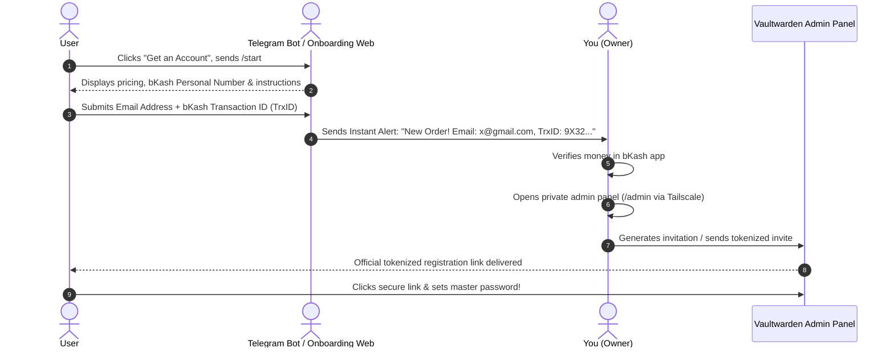

# 🔐 Vaultwarden Production Architecture & Monetization Blueprint

> **Project:** `03-vaultwarden-service`  
> **Hostname:** `vault.snowfox.live`  
> **Network Zone:** Safe Public Ingress (`vmbr2`, `10.20.20.0/24`)  
> **Security Posture:** Zero-Trust Ingress, Hardened Admin Isolation, Pay-to-Invite Onboarding Flow

---

## 🎯 Executive Summary & Objectives
Vaultwarden is our self-hosted, Bitwarden-compatible password manager. Because it holds critical secrets, passwords, and 2FA credentials, it requires maximum security hardening:
1. **Zero Open Router Ports:** Exposed to the internet exclusively via an encrypted Cloudflare Tunnel (`cloudflared`).
2. **Hardened Admin Isolation:** The `/admin` portal is completely blocked and returns `404 Not Found` on the public Cloudflare tunnel, and is accessible only through a dedicated internal listener (LAN/Tailscale).
3. **Monetized Onboarding (bKash / Nagad):** Public registration is disabled; users cannot create an account without payment verification.

---

## 🏗️ Ingress & Security Topology

```
[ Public User ]
       │
       ▼ (HTTPS / TLS 1.3)
[ Cloudflare Edge (vault.snowfox.live) ]
       │
       ├── WAF Rule: If path starts with "/admin" ➔ BLOCK
       │
       ▼ (Encrypted QUIC Tunnel)
[ cloudflared Daemon (10.20.20.10) ]
       │
       ▼ (Local Bridge / Origin CA SSL Full Strict)
[ Hardened Nginx Reverse Proxy (10.20.20.10 - nginx-public) ]
       │
       ├── Public Server Block:
       │     location /admin { return 404; }
       │     location / { proxy_pass http://vaultwarden_backend; }
       │     Inject Security Headers (HSTS, CSP with wasm-unsafe-eval, X-Frame-Options: DENY)
       │
[ Internal Tailscale / LAN Ingress ]
       │
       ▼ (Private Management Server Block)
       ├── location /admin { allow 10.10.10.0/24; allow 192.168.1.0/24; allow 100.64.0.0/10; deny all; proxy_pass ...; }
       │
       ▼ (Plain HTTP / Loopback)
[ Vaultwarden Container (10.20.20.11:8085) ]
```

---

## 🛡️ Security Hardening Rules

### 1. Geographic Access Restriction (Bangladesh Only 🇧🇩)
Because your users and customers are in Bangladesh, Vaultwarden should not be reachable by global botnets, credential stuffers, or automated scanners originating from outside the country.
- **Enforcement Layer:** Cloudflare WAF Custom Rule (Edge Enforcement).
- **Rule Definition:**
  - *Expression:* `(http.host eq "vault.snowfox.live" and ip.geoip.country ne "BD")`
  - *Action:* **Block** (or Managed Challenge).
- **Benefit:** Traffic from any country other than Bangladesh is dropped immediately at Cloudflare's nearest edge data center before it ever touches your tunnel or server bandwidth.
- **Exceptions:** If you travel abroad, you can still access your vault via Tailscale (`100.64.0.0/10`) without touching the public edge.

### 2. Admin Portal Lockdown (`/admin`)
- **Public Behavior (Cloudflare Tunnel Listener):** Hard 404 response. Because Cloudflare Tunnel ingress arrives locally from the tunnel daemon (`10.20.20.10`), relying on client IP checks on the public block is bypassable. Therefore, the public-facing server block returns an unconditional `404` for `/admin`.
- **Private Behavior (Internal / Tailscale Listener):** Served on a separate private listener or authenticated Tailscale mesh where `/admin` is forwarded to Vaultwarden backend with strict internal IP allowlists.

```nginx
# --- Public Server Block (Port 80/443 for Cloudflare Tunnel) ---
server {
    server_name vault.snowfox.live;
    
    # Unconditional hard 404 for public callers
    location /admin {
        return 404;
    }

    location / {
        proxy_pass http://vaultwarden_backend;
        proxy_set_header Host $host;
        proxy_set_header X-Real-IP $remote_addr;
        proxy_set_header X-Forwarded-For $proxy_add_x_forwarded_for;
        proxy_set_header X-Forwarded-Proto $scheme;
    }
}

# --- Private Internal Server Block (Local IP Only - Port 8443) ---
server {
    listen 10.20.20.10:8443 ssl;
    server_name vault-internal.snowfox.live;

    # Strictly local access only (no Tailscale or public WAN)
    location /admin {
        allow 10.10.10.0/24;
        allow 10.20.20.0/24;
        allow 192.168.1.0/24;
        deny all;

        proxy_pass http://vaultwarden_backend;
        proxy_set_header Host $host;
        proxy_set_header X-Real-IP $remote_addr;
        proxy_set_header X-Forwarded-For $proxy_add_x_forwarded_for;
        proxy_set_header X-Forwarded-Proto $scheme;
    }
}
```

### 3. Mandatory HTTP Security Headers
Applied in Nginx (including `'wasm-unsafe-eval'` required by modern Bitwarden Web Vault cryptography):
```nginx
add_header Strict-Transport-Security "max-age=31536000; includeSubDomains; preload" always;
add_header X-Frame-Options "DENY" always;
add_header X-Content-Type-Options "nosniff" always;
add_header Referrer-Policy "strict-origin-when-cross-origin" always;
add_header Content-Security-Policy "default-src 'self'; script-src 'self' 'wasm-unsafe-eval'; style-src 'self' 'unsafe-inline'; img-src 'self' data: https:; font-src 'self' data:; connect-src 'self' wss: https:;" always;
```

---

## 💰 Monetized Onboarding Flow (bKash / Nagad / Rocket)

### 1. Vaultwarden Core Configuration
```env
# Prevent open unauthenticated registrations
SIGNUPS_ALLOWED=false

# Allow authorized invitations with cryptographic tokens
INVITATIONS_ALLOWED=true

# Enforce secure authentication
SHOW_PASSWORD_HINT=false
PASSWORD_ITERATIONS=600000
```

### 2. Frontend UX Customization
Because URL fragments (like `#/register`) are evaluated entirely on the client side and never sent in HTTP request lines to Nginx, public signup interception cannot be handled via an Nginx HTTP 302 redirect.

Instead, registration gating is handled via:
1. **Disabling Open Signups:** Setting `SIGNUPS_ALLOWED=false` and `INVITATIONS_ALLOWED=true` in Vaultwarden environment variables.
2. **Web Vault Customization:** Injected JavaScript or custom static template modifying the web vault login interface:
   - Replaces the standard **"Create Account"** button with **"Get an Account (bKash / Nagad)"**.
   - Links directly to `https://t.me/SnowfoxVaultBot?start=signup` (or dedicated onboarding portal).

### 3. Step-by-Step Payment & Invitation Workflow


---

## 💾 Backup Strategy
- **Live Database:** SQLite / PostgreSQL mounted on persistent local-lvm storage.
- **Cold Backup Sync:** Encrypted nightly dumps mirrored to offsite cloud (Cloudflare R2 / S3 / Supabase storage bucket) to guarantee zero data loss.
