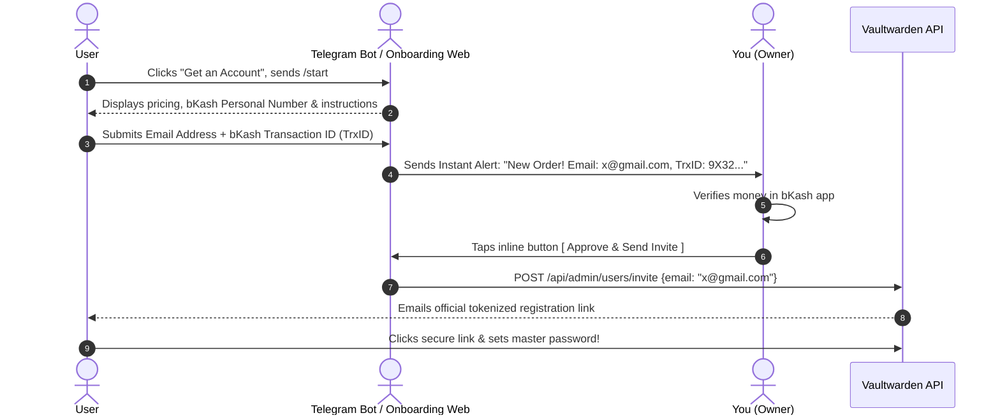

# 🔐 Vaultwarden Production Architecture & Monetization Blueprint

> **Project:** `03-vaultwarden-service`  
> **Hostname:** `vault.snowfox.live`  
> **Network Zone:** Safe Zone (`vmbr1`, `10.10.10.0/24`)  
> **Security Posture:** Zero-Trust Ingress, Hardened Admin Isolation, Pay-to-Invite Onboarding Flow

---

## 🎯 Executive Summary & Objectives
Vaultwarden is our self-hosted, Bitwarden-compatible password manager. Because it holds critical secrets, passwords, and 2FA credentials, it requires maximum security hardening:
1. **Zero Open Router Ports:** Exposed to the internet exclusively via an encrypted Cloudflare Tunnel (`cloudflared`).
2. **Hardened Admin Isolation:** The `/admin` portal is completely cloaked from the public web (returns `404 Not Found`).
3. **Monetized Onboarding (bKash / Nagad):** Public registration is disabled; users cannot create an account without payment verification.

---

## 🏗️ Ingress & Security Topology

```
[ Public User ]
       │
       ▼ (HTTPS / TLS 1.3)
[ Cloudflare Edge (vault.snowfox.live) ]
       │
       ├── WAF Rule: If path starts with "/admin" ➔ BLOCK
       │
       ▼ (Encrypted QUIC Tunnel)
[ cloudflared Daemon (10.10.10.10) ]
       │
       ▼ (Local Bridge / Origin CA SSL Full Strict)
[ Hardened Nginx Reverse Proxy (10.10.10.10) ]
       │
       ├── If URI is "/admin" AND client != [LAN / Tailscale] ➔ Return 404
       ├── If URI is "#/register" ➔ Redirect to Payment / Telegram Bot
       ├── Inject Security Headers (HSTS, CSP, X-Frame-Options: DENY)
       │
       ▼ (Plain HTTP / Loopback)
[ Vaultwarden Container (10.10.10.11:8085) ]
```

---

## 🛡️ Security Hardening Rules

### 1. Geographic Access Restriction (Bangladesh Only 🇧🇩)
Because your users and customers are in Bangladesh, Vaultwarden should not be reachable by global botnets, credential stuffers, or automated scanners originating from outside the country.
- **Enforcement Layer:** Cloudflare WAF Custom Rule (Edge Enforcement).
- **Rule Definition:**
  - *Expression:* `(http.host eq "vault.snowfox.live" and ip.geoip.country ne "BD")`
  - *Action:* **Block** (or Managed Challenge).
- **Benefit:** Traffic from any country other than Bangladesh is dropped immediately at Cloudflare's nearest edge data center before it ever touches your tunnel or server bandwidth.
- **Exceptions:** If you travel abroad, you can still access your vault via Tailscale (`100.64.0.0/10`) without touching the public edge.

### 2. Admin Portal Lockdown (`/admin`)
- **Public Behavior:** Returns `404 Not Found`. Scanners and attackers see no login prompt or indication that the panel exists.
- **Allowed Access Only Via:**
  - Home LAN (`192.168.1.0/24`)
  - Safe Zone (`10.10.10.0/24`)
  - Tailscale Tailnet (`100.64.0.0/10`)
- **Nginx Configuration:**
  ```nginx
  location /admin {
      # Restrict to trusted internal networks
      allow 10.10.10.0/24;
      allow 192.168.1.0/24;
      allow 100.64.0.0/10;
      deny all;

      # Cloak the endpoint from unauthorized callers
      return 404;

      proxy_pass http://vaultwarden_backend;
      proxy_set_header Host $host;
      proxy_set_header X-Real-IP $remote_addr;
      proxy_set_header X-Forwarded-For $proxy_add_x_forwarded_for;
      proxy_set_header X-Forwarded-Proto $scheme;
  }
  ```

### 2. Mandatory HTTP Security Headers
Applied in Nginx:
```nginx
add_header Strict-Transport-Security "max-age=31536000; includeSubDomains; preload" always;
add_header X-Frame-Options "DENY" always;
add_header X-Content-Type-Options "nosniff" always;
add_header Referrer-Policy "strict-origin-when-cross-origin" always;
add_header Content-Security-Policy "default-src 'self'; script-src 'self'; style-src 'self' 'unsafe-inline'; img-src 'self' data: https:; font-src 'self' data:; connect-src 'self' wss: https:;" always;
```

---

## 💰 Monetized Onboarding Flow (bKash / Nagad / Rocket)

### 1. Vaultwarden Core Configuration
```env
# Prevent open unauthenticated registrations
SIGNUPS_ALLOWED=false

# Allow authorized invitations with cryptographic tokens
INVITATIONS_ALLOWED=true

# Enforce secure authentication
SHOW_PASSWORD_HINT=false
PASSWORD_ITERATIONS=600000
```

### 2. Frontend UX Customization
On the standard Bitwarden web vault login page:
- The default **"Create Account"** button is intercepted via custom web-vault script injection or Nginx redirect:
  - Button text: **"Get an Account (bKash / Nagad)"**
  - Action link: `https://t.me/SnowfoxVaultBot?start=signup` (or dedicated web landing page).

### 3. Step-by-Step Payment & Invitation Workflow


---

## 💾 Backup Strategy
- **Live Database:** SQLite / PostgreSQL mounted on persistent local-lvm storage.
- **Cold Backup Sync:** Encrypted nightly dumps mirrored to offsite cloud (Cloudflare R2 / S3 / Supabase storage bucket) to guarantee zero data loss.
