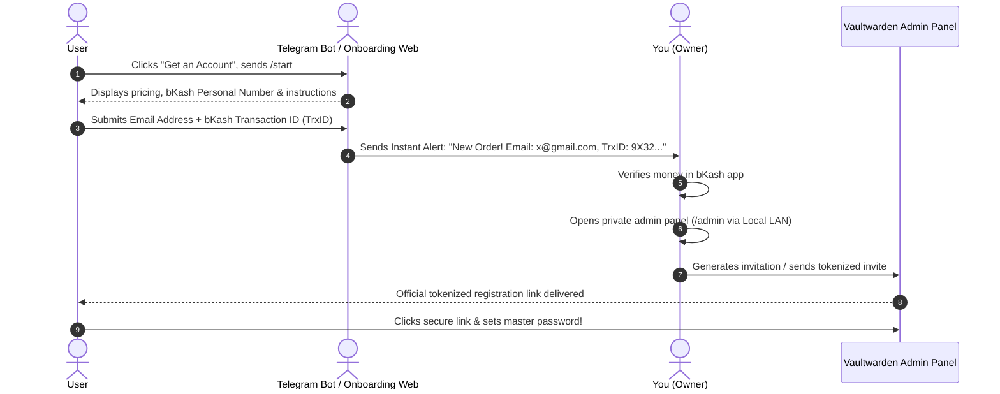

# 🔐 Vaultwarden Production Architecture & Monetization Blueprint

> **Project:** `03-vaultwarden-service`  
> **Hostname:** `vault.snowfox.live`  
> **Network Zone:** Safe Public Ingress (`vmbr2`, `10.20.20.0/24`)  
> **Security Posture:** Zero-Trust Ingress, Hardened Admin Isolation, Pay-to-Invite Onboarding Flow

---

## 🎯 Executive Summary & Objectives
Vaultwarden is our self-hosted, Bitwarden-compatible password manager. Because it holds critical secrets, passwords, and 2FA credentials, it requires maximum security hardening:
1. **Zero Open Router Ports:** Exposed to the internet exclusively via an encrypted Cloudflare Tunnel (`cloudflared`).
2. **Hardened Admin Isolation:** The `/admin` portal is completely blocked and returns `404 Not Found` on the public Cloudflare tunnel, and is accessible only through a dedicated internal listener on local LAN.
3. **Monetized Onboarding (bKash / Nagad):** Public registration is disabled; users cannot create an account without payment verification.

---

## 🏗️ Ingress & Security Topology

```
[ Public User ]
       │
       ▼ (HTTPS / TLS 1.3)
[ Cloudflare Edge (vault.snowfox.live) ]
       │
       ├── WAF Rule 1: If ip.geoip.country ne "BD" ➔ BLOCK
       ├── WAF Rule 2: If path starts with "/admin" ➔ BLOCK (403/Drop)
       │
       ▼ (Encrypted QUIC Tunnel)
[ cloudflared Daemon in LXC 202 (10.20.20.10) ]
       │
       ▼ (Local Host Bridge / Loopback Socket)
[ Hardened Nginx Reverse Proxy (10.20.20.10 - nginx-public) ]
       │
       ├── location /admin { 
       │       allow 192.168.1.197;    # Admin Workstation
       │       allow 10.10.10.0/24;     # Safe Management Zone
       │       deny all;                # Returns 403 Forbidden to any tunnel/untrusted IP
       │       proxy_pass https://10.20.20.11:8443;
       │   }
       │
       ├── location /notifications/hub {
       │       proxy_pass http://10.20.20.11:3012; # Isolated L2 WebSocket hub
       │   }
       │
       ├── location / { 
       │       proxy_pass https://10.20.20.11:8443; # Server-Verified TLS
       │       proxy_set_header X-Forwarded-Proto https;
       │       proxy_set_header X-Forwarded-Ssl on;
       │   }
       │
       ▼ (Encrypted HTTPS via Homelab Root CA)
[ Vaultwarden Container (10.20.20.11:8443 - ROCKET_TLS) ]
```

---

## 🛡️ Security Hardening Rules

### 1. Geographic Access Restriction (Bangladesh Only 🇧🇩)
Because your users and customers are in Bangladesh, Vaultwarden should not be reachable by global botnets, credential stuffers, or automated scanners originating from outside the country.
- **Enforcement Layer:** Cloudflare WAF Custom Rule (Edge Enforcement).
- **Rule Definition:**
  - *Expression:* `(http.host eq "vault.snowfox.live" and ip.geoip.country ne "BD")`
  - *Action:* **Block** (or Managed Challenge).
- **Benefit:** Traffic from any country other than Bangladesh is dropped immediately at Cloudflare's nearest edge data center before it ever touches your tunnel or server bandwidth.
- **Exceptions:** If you are outside Bangladesh, access is managed through authenticated WireGuard/VPN rather than public edge relaxation.

### 2. Admin Portal Lockdown (`/admin`)
- **Public Behavior (Cloudflare Tunnel Listener):** Hard 404 response. Because Cloudflare Tunnel ingress arrives locally from the tunnel daemon (`10.20.20.10`), relying on client IP checks on the public block is bypassable. Therefore, the public-facing server block returns an unconditional `404` for `/admin`.
- **Private Behavior (Internal LAN Listener):** Served on a separate private listener (`:8443`) restricted strictly to the administrator's workstation IP (`192.168.1.197/32`) and Safe Zone (`10.10.10.0/24`). Tailscale, public internet, and unprivileged container IPs receive an immediate `deny`.

```nginx
# --- Public Server Block (Port 80/443 for Cloudflare Tunnel) ---
server {
    server_name vault.snowfox.live;
    
    # Unconditional hard 404 for public callers
    location /admin {
        return 404;
    }

    location / {
        proxy_pass http://vaultwarden_backend;
        proxy_set_header Host $host;
        proxy_set_header X-Real-IP $remote_addr;
        proxy_set_header X-Forwarded-For $proxy_add_x_forwarded_for;
        proxy_set_header X-Forwarded-Proto $scheme;
    }
}

# --- Private Internal Server Block (Local IP Only - Port 8443) ---
server {
    listen 10.20.20.10:8443 ssl;
    server_name vault-internal.snowfox.live;

    # Strictly local administrator workstation & safe zone only
    location /admin {
        allow 192.168.1.197/32;
        allow 10.10.10.0/24;
        deny all;

        proxy_pass http://vaultwarden_backend;
        proxy_set_header Host $host;
        proxy_set_header X-Real-IP $remote_addr;
        proxy_set_header X-Forwarded-For $proxy_add_x_forwarded_for;
        proxy_set_header X-Forwarded-Proto $scheme;
    }
}
```

### 3. Mandatory HTTP Security Headers
Applied in Nginx (including `'wasm-unsafe-eval'` required by modern Bitwarden Web Vault cryptography):
```nginx
add_header Strict-Transport-Security "max-age=31536000; includeSubDomains; preload" always;
add_header X-Frame-Options "DENY" always;
add_header X-Content-Type-Options "nosniff" always;
add_header Referrer-Policy "strict-origin-when-cross-origin" always;
add_header Content-Security-Policy "default-src 'self'; script-src 'self' 'wasm-unsafe-eval'; style-src 'self' 'unsafe-inline'; img-src 'self' data: https:; font-src 'self' data:; connect-src 'self' wss: https:;" always;
```

---

## 💰 Monetized Onboarding Flow (bKash / Nagad / Rocket)

### 1. Vaultwarden Core Configuration
```env
# Prevent open unauthenticated registrations
SIGNUPS_ALLOWED=false

# Allow authorized invitations with cryptographic tokens
INVITATIONS_ALLOWED=true

# Enforce secure authentication
SHOW_PASSWORD_HINT=false
PASSWORD_ITERATIONS=600000
```

### 2. Frontend UX Customization
Because URL fragments (like `#/register`) are evaluated entirely on the client side and never sent in HTTP request lines to Nginx, public signup interception cannot be handled via an Nginx HTTP 302 redirect.

Instead, registration gating is handled via:
1. **Disabling Open Signups:** Setting `SIGNUPS_ALLOWED=false` and `INVITATIONS_ALLOWED=true` in Vaultwarden environment variables.
2. **Web Vault Customization:** Injected JavaScript or custom static template modifying the web vault login interface:
   - Replaces the standard **"Create Account"** button with **"Get an Account (bKash / Nagad)"**.
   - Links directly to `https://t.me/SnowfoxVaultBot?start=signup` (or dedicated onboarding portal).

### 3. Step-by-Step Payment & Invitation Workflow


---

## 🚀 Advanced Capabilities & Integration Potential

Beyond basic password storage, Vaultwarden unlocks the full suite of enterprise-grade Bitwarden features without licensing fees:

### 1. Built-in Security & Auditing Tools
- **Password Health & Breach Reports (`bw report password-health`):** Audits vault credentials against Have I Been Pwned (HIBP) using zero-knowledge $k$-anonymity SHA-1 hash prefixes. Integrated with **Project 08 (n8n)** and **Project 09 (Telegram Bot Hub)** for 10-minute automated monitoring and Telegram alerting.
- **Exposed Passwords & Reused Credentials Report:** Identifies duplicate credentials across different accounts to prevent credential-stuffing vulnerabilities.
- **Weak Passwords & Unencrypted Websites Report:** Flags items missing TLS encryption (`http://`) or failing length/complexity policies.
- **Inactive 2FA Report:** Identifies online accounts that support two-factor authentication where TOTP has not yet been configured in the vault.

### 2. Digital Legacy & Emergency Access
- **Emergency Access (Digital Will):** Allows designating trusted contacts ("grantees") who can request access to your vault if you become incapacitated or lose master credentials.
- **Configurable Takeover Wait Period:** Grantees can be granted *View-only* or *Takeover* access, gated by a customizable cooling-off wait delay (e.g. 7 days), giving you time to deny unauthorized requests.

### 3. Encrypted Ephemeral Sharing (Bitwarden Send)
- **Zero-Knowledge File & Secret Transfers:** Securely send temporary credentials, API keys, or files (up to configured attachment limits) to third parties or friends via encrypted expiring links.
- **Granular Access Constraints:** Configurable expiration timestamps (e.g., 1 hour, 1 day), maximum download counts (burn-after-read), and optional passcodes.

### 4. Organizations, Collections & Granular Access Controls
- **Family & Team Vaults:** Share specific password items across multiple users using fine-grained Collections without exposing entire vaults.
- **Hide Passwords Permission:** Allows team members or family to auto-fill credentials into browser forms without viewing the plaintext password.

### 5. Native Two-Factor Authentication & Passkey (FIDO2) Storage
- **Built-in TOTP Authenticator:** Generates time-based 6-digit verification codes natively in the browser extension and mobile apps.
- **Passkey / WebAuthn Storage:** Stores public/private keypairs for passkey-enabled websites directly within vault records.

---

## 💾 Backup Strategy
- **Live Database:** Centralized PostgreSQL instance on Dedicated Database Tier (`vmbr7`, `10.70.70.10:5432`).
- **Cold Backup Sync:** Encrypted nightly dumps mirrored to offsite cloud (Cloudflare R2 / S3 / Supabase storage bucket) to guarantee zero data loss.

---

## 🔮 Future Roadmap & Automation Backlog

The following capabilities are marked for in-depth exploration, hardening, and phased rollout:

### 1. In-Depth Admin Panel Exploration & Feature Auditing
- **Master Feature Audit:** Systematically explore and document every advanced toggle in the private `/admin` panel:
  - Custom environment overrides.
  - Granular cipher attachment limits and file storage quotas.
  - Device session purge intervals and token lifetimes.
  - Organization policy enforcement (e.g. minimum password strength, forced 2FA for all members).

### 2. Transactional Email & Email OTP Provisioning (SMTP)
- **Email Service Integration:** Connect a dedicated transactional email relay (e.g. Brevo, Mailgun, Amazon SES, or self-hosted mail on `vmbr5`):
  - **Email-based 2FA / Login Verification Codes:** High-assurance OTPs dispatched on unfamiliar logins.
  - **Automated Invitations:** Automatic delivery of tokenized registration links when adding family or paid customers.
  - **Security Alerts:** Immediate email notifications on password changes, new device authorizations, or emergency access requests.

### 3. Advanced Workflow & Security Automations
- **n8n Automated Provisioning (Project 08):**
  - Webhook integration listening for bKash/Nagad payment triggers to automatically call Vaultwarden API and issue invite tokens.
- **HIBP Leak Incident Cascade (Project 08 & 10):**
  - Scheduled 10-minute Bitwarden CLI vault audits triggering Telegram alerts and automated local PC malware triage.
- **Automated Organization Sync & Directory Connector:**
  - Automated syncing of users and collections using LDAP or custom API connectors.
