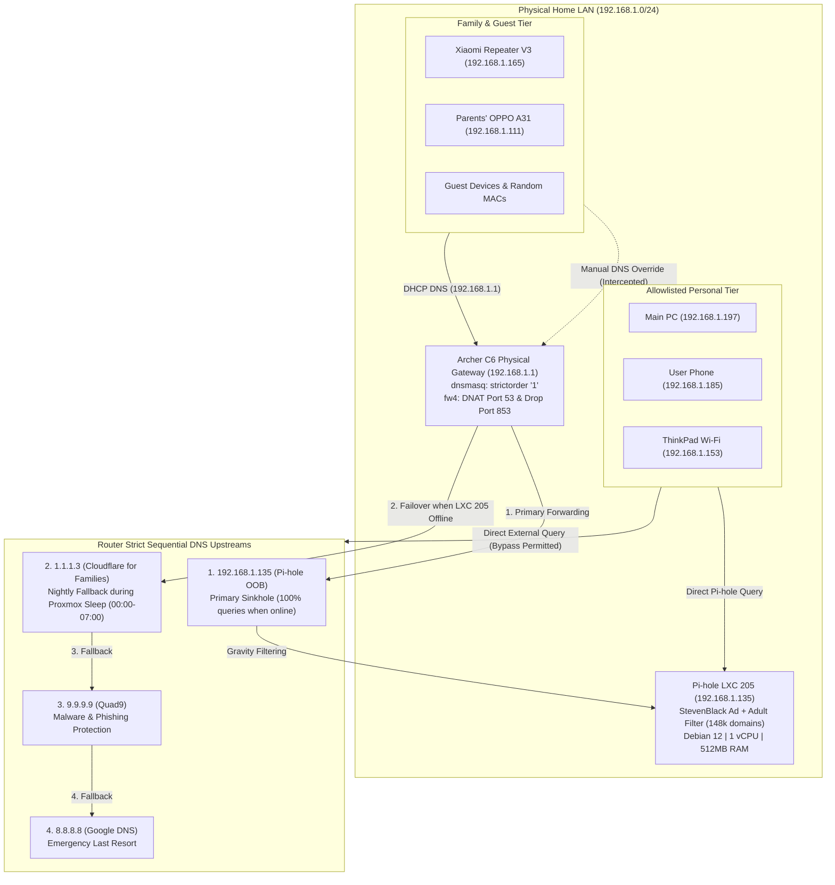

# 🛡️ Out-of-Band Pi-hole DNS Sinkhole & Parental Controls

> **Project ID:** `07-pihole-dns-sinkhole`  
> **Status:** Live & Production-Verified  
> **Container ID:** Proxmox LXC 205 (`pihole-oob`)  
> **Network Location:** `192.168.1.135` on `vmbr0` (Home LAN / Out-of-Band)  
> **Web Admin Interface:** `http://192.168.1.135/admin`  
> **Architectural Decision Record:** [[../../knowledge/architecture-decisions#ADR-005 Out-of-Band Pi-hole DNS Sinkhole and Strict Fallback Parental Controls|ADR-005]]

---

## 🎯 Project Objectives & Purpose

1. **Hardware Offload:** Offload all heavy DNS filtering, adblocking, and domain sinkholing away from the resource-constrained TP-Link Archer C6 v3 router (16MB flash, 128MB RAM) into the Proxmox hypervisor, preventing MT7603E wireless driver crashes and out-of-memory lockups.
2. **Universal Content Protection:** Enforce a strict network-wide baseline that eliminates adult/pornographic domains, known malware/phishing hosts, and intrusive advertising across all home devices.
3. **Fail-Safe Nightly Fallback:** Guarantee uninterrupted, filtered DNS resolution during the nightly Proxmox power-down window (00:00 to 07:00 AM) through router-enforced sequential upstream failover to Cloudflare for Families (`1.1.1.3`).
4. **DNS Bypass Resistance & Hardening:** Enforce strict DNS bypass resistance against unauthorized manual DNS overrides (port 53 DNAT redirection) and encrypted DNS leaks (port 853 DoT/DoQ dropping) on the physical router.

---

## 🛡️ Threat Model & Bypass Resistance Boundaries

In enterprise network defense, port-level filtering provides **high bypass resistance**, but cannot be considered absolute without host-level MDM:
1. **Conventional Port 53 Overrides:** 100% neutralized. Any client attempting to use `8.8.8.8:53` or `1.1.1.1:53` is transparently DNAT-redirected to `192.168.1.1:53` and filtered through Pi-hole.
2. **DNS-over-TLS & DNS-over-QUIC (Port 853):** 100% neutralized. Rejected at the firewall, forcing Android "Private DNS" and iOS encrypted clients to fall back to port 53.
3. **DNS-over-HTTPS (DoH Port 443):**
   - *Challenge:* DoH packets travel over standard TLS port 443, indistinguishable from ordinary HTTPS web traffic.
   - *Mitigation:* Pi-hole returns NXDOMAIN for the Mozilla Firefox canary domain (`use-application-dns.net`), disabling automatic browser DoH. Router blocklists drop known bootstrap IPs for major public DoH endpoints.
4. **MAC Address Randomization & Spoofing:**
   - Layer-2 MAC allowlists are an operational heuristic, not cryptographic device identity.
   - Non-allowlisted family and repeater clients remain in the restricted baseline. If an allowlisted device enables MAC randomization, it automatically falls back into the restricted group.

---

## ⏱️ Empirical Failover Benchmark (Pi-hole Offline Drill)

During live failover testing, Pi-hole (LXC 205) was stopped to measure client resolution behavior:
```bash
# Test command executed while LXC 205 was powered down:
ssh router "time nslookup pornhub.com 127.0.0.1"

# Observed Output:
Server:      127.0.0.1
Address:     127.0.0.1:53
Name:        pornhub.com
Address:     0.0.0.0
Address:     ::
real:        0m 2.51s
```
**Empirical Findings:**
- **Filtering Continuity:** When Pi-hole is offline (e.g. 00:00 to 07:00 AM Proxmox sleep), Cloudflare for Families (`1.1.1.3`) successfully intercepts and blocks adult domains (`0.0.0.0`).
- **Query Latency:** Uncached lookups experience an initial **2.51-second UDP timeout** while `dnsmasq` waits for the primary Pi-hole socket to fail before sequentially promoting `1.1.1.3`. Cached records resolve in `0.00s`.

---

## 🏗️ Architecture & Component Topology



---

## ⚙️ Container Specifications & Configuration

| Parameter | Value | Source / Notes |
| :--- | :--- | :--- |
| **Container ID** | `205` | Proxmox LXC |
| **Container Hostname** | `pihole-oob` | Out-of-Band Management Tier |
| **Base Image** | `debian-12-standard_12.7-1_amd64.tar.zst` | Debian 12 Bookworm |
| **Network Device** | `eth0` bridged to `vmbr0` | Home LAN / Out-of-Band Bridge |
| **Static IPv4** | `192.168.1.135/24` | Gateway: `192.168.1.1` |
| **MAC Address** | `$MAC_PIHOLE_OOB` | Mapped in `.env` |
| **Compute Quota** | 1 vCPU, 512 MB RAM, 512 MB Swap | Hypervisor isolated |
| **Disk Storage** | 4.0 GB Root Disk | `local-lvm` |
| **Hypervisor Flags** | `nesting=1`, `onboot=1` | Boots automatically with hypervisor |
| **Pi-hole Version** | Core v6.5, Web v6.6.1, FTL v6.8 | Pi-hole v6 modern architecture |

---

## 🚫 Blocklists & Filtering Boundaries

Pi-hole maintains its blocklists in SQLite database format (`/etc/pihole/gravity.db`):

### 1. Active Adlists
1. **Adlist 1 (Adware, Malware & Telemetry):**
   - **URL:** `https://raw.githubusercontent.com/StevenBlack/hosts/master/hosts`
   - **Domains Blocked:** ~40,000+ domains.
2. **Adlist 2 (Unified Adult, Pornographic & NSFW):**
   - **URL:** `https://raw.githubusercontent.com/StevenBlack/hosts/master/alternates/porn/hosts`
   - **Unique Domains in Gravity:** **148,038 unique blocked domains**.

### 2. Multi-Tier Client Group Architecture
While the current policy enforces a uniform baseline across the entire household, clients are cleanly separated into database groups to support future granular policies without migration:
- **Group 0 (`Default`):** Contains Adlist 1 + Adlist 2. Applied to all queries forwarded by the physical router (`192.168.1.1`) and unmapped guest/repeater stations.
- **Group 1 (`Whitelisted-Devices`):** Contains Adlist 1 + Adlist 2. Assigned to personal workstation PC (`192.168.1.197`), Realme phone (`192.168.1.185`), and ThinkPad Wi-Fi (`192.168.1.153`).

---

## 🔗 Cross-Project Relationships & Interdependencies

| Related Project | Interface / Dependency Point | How It Interacts |
| :--- | :--- | :--- |
| [00-proxmox-host](../00-proxmox-host/runbook.md) | Host Hypervisor & Power Management | Hosts LXC 205 on `vmbr0`. Controls nightly sleep (00:00) and 7:00 AM RTC/WOL wake-up cycles. |
| [01-dual-openwrt-routing](../01-dual-openwrt-routing/runbook.md) | Gateway Routing, DHCP & Firewall | Upstream `dnsmasq` sequential failover, DHCP option announcement, Layer-2 `fw4` MAC allowlist, and anti-bypass DNAT rules. |
| [ADR-005](../../knowledge/architecture-decisions.md#adr-005-out-of-band-pi-hole-dns-sinkhole-and-strict-fallback-parental-controls) | Architectural Decision Log | Formal decision record, problem statement, threat model, and verification proofs. |
| [inventory.md](../../inventory.md) | Asset Registry | Master entry for LXC 205, `MAC_PIHOLE_OOB`, and active deployment status. |

---

## 📖 Operational Runbook Reference

For day-to-day administration, gravity updates, client-group database queries, and troubleshooting procedures, see the companion runbook:
- 📘 [[runbook|Pi-hole Operations & Maintenance Runbook]]
