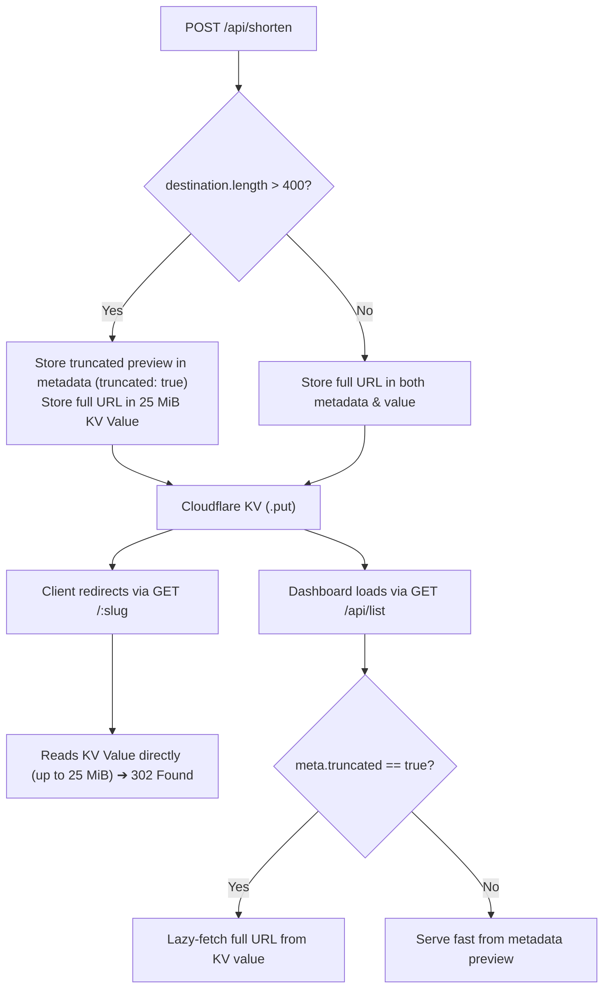
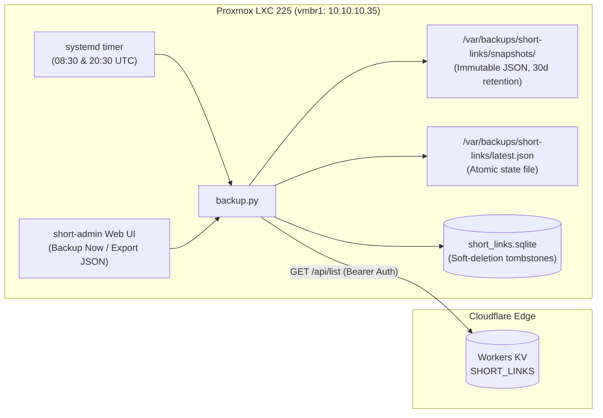

# 🔗 Project 13: Personal URL Shortener (`short.snowfox.live`)

> **Project ID:** `13-personal-url-shortener`  
> **Status:** Production / Fully Deployed & Verified  
> **Target Public Domain:** `https://short.snowfox.live/abcdxyz`  
> **Target Management Web UI:** Safe Internal Zone (`vmbr1`, `10.10.10.35` / `short-admin.snowfox.live`)  
> **Security Model:** **Strict Geo-Fencing** (Bangladesh Only) + **Air-Gapped Private Admin UI** (`vmbr1`) + **Serverless 24/7 Edge Redirection** (Cloudflare Workers + KV)

---

## 🎯 1. Overview & Core Requirements

This project delivers a personal, high-performance URL shortening platform with strict geographic access controls and total administrative privacy:
1. **Branded Public Short URLs:** Short, memorable URLs under `https://short.snowfox.live/slug` for resumes, social media, documentation, and sharing.
2. **Bangladesh-Only Geo-Fence (`BD`):** Redirection links are strictly restricted to visitors located within Bangladesh. Requests originating from outside Bangladesh are terminated immediately at Cloudflare's edge.
3. **24/7/365 Edge Availability:** Operates independently of the Proxmox ThinkPad server's nightly power schedule (offline 00:00–07:00 AM per `power-manager.sh`). Public links never experience downtime.
4. **Air-Gapped Private Management UI in `vmbr1`:** A clean, dedicated 2-page web application hosted entirely within the **Safe Internal Zone (`vmbr1`)** with **zero public internet ingress**.
5. **Outbound-Only Cloudflare Synchronization:** The management website communicates with Cloudflare's API strictly via **outbound HTTPS**, ensuring the administration portal is invisible and unreachable to external scanners.

---

## 🏗️ 2. Dual-Tier System Architecture

```
═════════════════════════════════════════════════════════════════════════════════════════════
                       TIER 1: 24/7 GLOBAL EDGE (CLOUDFLARE)
═════════════════════════════════════════════════════════════════════════════════════════════
                                   │
                    Public Visitor │ (GET https://short.snowfox.live/xyz)
                                   ▼
                   ┌───────────────────────────────┐
                   │  Cloudflare Edge WAF / Worker │
                   └───────────────┬───────────────┘
                                   │
              ┌────────────────────┴────────────────────┐
              │                                         │
        [ Country != "BD" ]                       [ Country == "BD" ]
              │                                         │
              ▼                                         ▼
   HTTP 403 Forbidden                        Cloudflare KV Store Lookup
   "Access Restricted to BD"                  Key: "xyz" ➔ Target URL
                                                        │
                                                        ▼
                                             HTTP 302 Redirect to Target
                                             (<15ms Response Time)

═════════════════════════════════════════════════════════════════════════════════════════════
               TIER 2: PRIVATE INTERNAL MANAGEMENT (HOMELAB vmbr1)
═════════════════════════════════════════════════════════════════════════════════════════════

   Owner Workstation (192.168.1.197) / Tailscale
        │
        │ HTTP (LAN Only - No Public DNS)
        ▼
   ┌───────────────────────────────────────────────┐
   │  Shortener Web UI (LXC on vmbr1: 10.10.10.35) │
   │  - Page 1: Link Generator & Output Card       │
   │  - Page 2: Master Short Link Registry Table   │
   └───────────────────────┬───────────────────────┘
                           │
                           │ Outbound HTTPS API (Bearer Token / Secret Key)
                           │ (Permitted via OpenWrt VM NAT forwarding)
                           ▼
              Cloudflare KV API Endpoint
              (Pushes new slugs / Fetches all links / Deletes entries)
```

---

## 🌐 3. Tier 1: Cloudflare Edge Worker & Geo-Fencing Engine

### 3.1 Edge Worker Logic & Bangladesh Geo-Fencing
The Cloudflare Worker intercepts all incoming HTTP requests to `short.snowfox.live`:

```javascript
export default {
  async fetch(request, env) {
    const url = new URL(request.url);
    const country = request.cf?.country;

    // 1. Enforce Strict Bangladesh-Only Geo-Fence
    if (country !== "BD") {
      return new Response(
        `<!DOCTYPE html>
        <html>
        <head><title>Access Restricted</title></head>
        <body style="font-family:sans-serif;text-align:center;padding:4rem;background:#0f172a;color:#f8fafc;">
          <h1 style="color:#ef4444;">🚫 Access Restricted</h1>
          <p>This redirection service is strictly restricted to visitors within Bangladesh.</p>
        </body>
        </html>`,
        {
          status: 403,
          headers: { "Content-Type": "text/html; charset=utf-8" }
        }
      );
    }

    // 2. Handle Management API Requests (Strictly Authenticated)
    if (url.pathname.startsWith("/api/")) {
      const authHeader = request.headers.get("Authorization");
      if (!authHeader || authHeader !== `Bearer ${env.SHORTENER_SECRET_TOKEN}`) {
        return new Response(JSON.stringify({ error: "Unauthorized" }), { status: 401 });
      }

      // API Routes for vmbr1 Management Dashboard
      if (request.method === "POST" && url.pathname === "/api/shorten") {
        const { slug, destination, title } = await request.json();
        await env.SHORT_LINKS.put(slug, destination, {
          metadata: { title, created_at: Date.now(), clicks: 0 }
        });
        return new Response(JSON.stringify({ success: true, short_url: `https://short.snowfox.live/${slug}` }), { status: 201 });
      }

      if (request.method === "GET" && url.pathname === "/api/list") {
        const list = await env.SHORT_LINKS.list();
        return new Response(JSON.stringify(list), { status: 200 });
      }

      if (request.method === "DELETE" && url.pathname.startsWith("/api/delete/")) {
        const slugToDelete = url.pathname.replace("/api/delete/", "");
        await env.SHORT_LINKS.delete(slugToDelete);
        return new Response(JSON.stringify({ success: true }), { status: 200 });
      }

      return new Response(JSON.stringify({ error: "Not Found" }), { status: 404 });
    }

    // 3. Handle Public Redirection (GET /slug)
    const slug = url.pathname.slice(1);
    if (!slug) {
      // Root access redirects safely to main personal portfolio
      return Response.redirect("https://snowfox.live", 302);
    }

    const destination = await env.SHORT_LINKS.get(slug);
    if (destination) {
      return Response.redirect(destination, 302);
    }

    return new Response("Short link not found", { status: 404 });
  }
};
```

---

## 🖥️ 4. Tier 2: Private Management Web Application (`vmbr1`)

### 4.1 Why `vmbr1` (Safe Internal) is Ideal
1. **Zero Public Attack Surface:** `vmbr1` is quarantined from the public internet by OpenWrt VM's firewall (`input: DROP`, `forward: DROP` for inbound traffic).
2. **Outbound Communication Feasibility:** OpenWrt allows outbound NAT routing from `vmbr1` to WAN. The web application can query `https://short.snowfox.live/api/...` or `https://api.cloudflare.com` over outbound HTTPS without requiring any open ports or reverse proxy tunnels into `vmbr1`.
3. **Internal Access:** Accessible on your local network via internal DNS (`http://short.internal.lab` or `http://10.10.10.35:8080`) or through your Tailscale network.

### 4.2 Web Application Structure (2 Pages / Views)

```
┌────────────────────────────────────────────────────────────────────────┐
│  ⚡ Snowfox Short Links Manager                [ Generator ] [ All Links ] │
├────────────────────────────────────────────────────────────────────────┤
│                                                                        │
│   Page 1: Link Generator                                               │
│   ───────────────────────────────────────────────────────────          │
│   Destination URL: [ https://github.com/snowfox-rubait/lab           ] │
│   Custom Slug:     [ lab-notebook        ] (Optional - auto-generates) │
│   Link Description:[ Homelab Engineering Repo                        ] │
│                                                                        │
│   [ ⚡ Shorten URL ]                                                   │
│                                                                        │
│   ┌──────────────────────────────────────────────────────────────┐     │
│   │ Result: https://short.snowfox.live/lab-notebook      [Copy]  │     │
│   └──────────────────────────────────────────────────────────────┘     │
│                                                                        │
└────────────────────────────────────────────────────────────────────────┘

┌────────────────────────────────────────────────────────────────────────┐
│  ⚡ Snowfox Short Links Manager                [ Generator ] [ All Links ] │
├────────────────────────────────────────────────────────────────────────┤
│                                                                        │
│   Page 2: All Shortened URLs (Master Registry)                         │
│   ───────────────────────────────────────────────────────────          │
│   Search: [ Filter links... ]                                          │
│                                                                        │
│   Short Link          Destination                  Created      Action │
│   ─────────────────── ──────────────────────────── ──────────── ────── │
│   /lab-notebook       github.com/snowfox-rubait/lab 2026-10-29   [Del] │
│   /resume             drive.google.com/file/...    2026-10-25   [Del] │
│   /blog               snowfox.live/notes           2026-10-20   [Del] │
│                                                                        │
└────────────────────────────────────────────────────────────────────────┘
```

#### Tech Stack:
- **Backend:** Lightweight Python (FastAPI / Flask) or Go single-binary container.
- **Frontend:** Responsive, clean dark-mode HTML/CSS/Vanilla JS (matches the sleek UI design of WAN Controller LXC 200).
- **Footprint:** **< 30 MB RAM**, minimal CPU usage.

---

## 🔒 5. Security & Threat Modeling

1. **Strict Bangladesh Geo-Fence Defense-in-Depth:**
   - **Layer 1 (Cloudflare WAF Custom Rule):** Rule expression `(http.host eq "short.snowfox.live" and ip.geoip.country ne "BD")` configured with action `Block`.
   - **Layer 2 (Worker Runtime Check):** `request.cf.country !== "BD"` evaluated at runtime before any KV read is executed.
2. **Secret Token Isolation:**
   - The master authorization token (`SHORTENER_SECRET_TOKEN`) is stored as an encrypted secret in Cloudflare Worker environment variables and mounted via `.env` in the private `vmbr1` web UI.
   - It is never exposed in client-side JavaScript or public HTTP responses.
3. **No Unauthenticated Link Creation:**
   - Public visitors have zero access to link creation APIs. Attempted POST/DELETE requests without the master bearer token receive `401 Unauthorized`.

---

## 📋 6. Implementation Artifacts & Deployment Status

### Implemented Files:
- **Cloudflare Edge Worker:**
  - Script: [`worker/worker.js`](worker/worker.js) (BD geo-fencing + KV redirect + token API)
  - Wrangler Config: [`worker/wrangler.toml`](worker/wrangler.toml) (KV bindings and routing)
  - Deployment Helper: [`worker/setup.sh`](worker/setup.sh)
- **Safe Internal Web UI & Backup Engine (`vmbr1`):**
  - Application Daemon: [`manager/app.py`](manager/app.py) (Zero-dependency Python 3 HTTP server + SPA frontend + backup API)
  - Backup & Archival Engine: [`manager/backup.py`](manager/backup.py) (KV snapshot exporter, SQLite sync, soft-deletion tracking)
  - Backup Service: [`manager/short-links-backup.service`](manager/short-links-backup.service) (Systemd oneshot unit)
  - Backup Timer: [`manager/short-links-backup.timer`](manager/short-links-backup.timer) (Twice-daily catchup timer)
  - Service Configuration: [`manager/short-manager.service`](manager/short-manager.service)
  - Environment Template: [`manager/.env.example`](manager/.env.example)
  - Automated LXC Installer: [`manager/install.sh`](manager/install.sh)
- **Infrastructure as Code (pyinfra):**
  - Task Module: [`iac/tasks/short_manager.py`](../../iac/tasks/short_manager.py)
  - Fleet Inventory: [`iac/inventory.py`](../../iac/inventory.py)

---

## 🚀 7. Deployment Roadmap & Next Steps

- [x] **Phase 1: Edge Redirection Engine & API**
  - Scaffolded [`worker/worker.js`](worker/worker.js) with Bangladesh geo-fence, KV CRUD endpoints, and `setup.sh`.
- [x] **Phase 2: Private 2-Page Web Management Application**
  - Developed zero-dependency [`manager/app.py`](manager/app.py) (Page 1: Link Generator with copy output, Page 2: Link Registry table with live search and deletion).
- [x] **Phase 3: Deploy Worker & KV to Cloudflare via Terraform**
  - Provisioned Cloudflare Workers KV namespace `SHORT_LINKS`, deployed ES module `snowfox-shortener`, configured custom route `short.snowfox.live/*`, and registered DNS A dummy record (`192.0.2.1` proxied).
- [x] **Phase 4: Proxmox LXC Container Provisioning (`vmbr1`)**
  - Launched Debian 13 LXC 225 on `vmbr1` (`10.10.10.35`) via Terraform [`iac/terraform/proxmox/lxc-short-manager.tf`](../../iac/terraform/proxmox/lxc-short-manager.tf).
  - Deployed `app.py`, created systemd service `short-manager.service`, and linked internal reverse proxy [`nginx-safe.conf`](../../projects/02-per-zone-nginx-proxies/nginx-safe.conf) under `short-admin.snowfox.live`.
- [x] **Phase 5: Verification & Geo-Fence Audit**
  - Verified link creation and deletion from internal web UI (`https://short-admin.snowfox.live`).
  - Verified public 302 redirection from Bangladesh Cloudflare Edge (Chittagong `CGP` PoP).
  - Verified credentials saved securely in Bitwarden vault under "Homelab & Infrastructure".
- [x] **Phase 6: Automated Local Backup & Lifecycle Management**
  - Deployed [`manager/backup.py`](manager/backup.py) on LXC 225 with SQLite historical tracking and JSON snapshots.
  - Activated systemd timer `short-links-backup.timer` (running at 08:30 and 20:30 with boot catchup).
  - Integrated 1-click "Backup Now" and "Export JSON" directly into the admin web UI.

---

## 🧩 8. Architecture Deep Dives & Production Edge-Cases

### 8.1 Cloudflare Workers KV Metadata Limit (`413 Payload Too Large`)

#### The Problem:
When creating or shortening URLs with long query parameters, Google search tokens, session IDs, or affiliate tracking strings (> ~400–500 characters), the creation request failed with:
`Failed to process request (KV PUT failed: 413 Payload Too Large)`

#### The Root Cause:
Cloudflare Workers KV provides two distinct storage mechanisms with radically different capacity limits:
1. **Key Value:** Up to **25 MiB** per key.
2. **Key Metadata (`{ metadata }`):** Hard cap of **1024 bytes (1 KiB)** of JSON.

To avoid an expensive $N+1$ query pattern when loading the dashboard registry table (`/api/list`), the original implementation stored the destination URL in both the KV value AND the metadata object. When a user shortened a long URL, `JSON.stringify(metadata)` exceeded 1,024 bytes, causing Cloudflare KV runtime to immediately abort the `.put()` operation with HTTP 413.

#### The Solution (Two-Tier Storage & Lazy Hydration):
We re-architected the storage and retrieval pipeline in [`worker/worker.js`](worker/worker.js):



1. **Write Path (`POST /api/shorten`):**
   - If `destination.length > 400`, the worker stores a truncated preview (`destination.slice(0, 400)`) in metadata with `truncated: true`.
   - The full, untruncated destination URL is **always committed to the 25 MiB KV value** without data loss.
2. **Public Redirection Engine (`GET /:slug`):**
   - Edge redirects directly consume `record.value` from `env.SHORT_LINKS.getWithMetadata(slug)`. Redirection has full 25 MiB headroom and is completely unaffected by metadata limits.
3. **Registry Hydration (`GET /api/list`):**
   - The worker lists keys using metadata for high performance.
   - If `meta.truncated === true` (or if metadata is missing), the worker lazily retrieves the complete URL with `await env.SHORT_LINKS.get(key.name)`.
4. **Verification:**
   - Tested and verified with a **1,254-character destination URL**. Link was created successfully (`201 Created`), redirected seamlessly (`302 Found`), and listed in full on the admin dashboard.

---

### 8.2 Split Architecture & Negative DNS Caching (`NXDOMAIN`)

#### Architecture Overview:
- **`short-admin.snowfox.live` (Tier 2 - Private Management):**
  - Hosted locally in Proxmox LXC 225 (`10.10.10.35:8080`) on the Safe Internal Zone (`vmbr1`).
  - Zero inbound public ingress; reachable strictly via Split-Horizon DNS or Tailscale.
- **`short.snowfox.live` (Tier 1 - Public Redirection Edge):**
  - Hosted globally on Cloudflare Edge (Workers + KV) with strict Bangladesh geo-fencing.

#### Negative Caching Trap:
Querying `short.snowfox.live` before Terraform provisioned the Cloudflare DNS record caused local resolvers (systemd-resolved, Pi-hole v6) to cache the negative response (`NXDOMAIN`). Even after successful deployment, internal services failed with Python's `[Errno -2] Name or service not known`.
- **Resolution:** Restarted `pihole-FTL.service` to flush Pi-hole v6's in-memory query cache (`pihole reloaddns` only flushes blocklists) and executed `resolvectl flush-caches` on the host.

---

### 8.3 Data Storage, Permanence & Lifecycle Architecture

#### Where Short Links are Stored:
1. **Cloud-Native Edge Storage (Cloudflare Workers KV):**
   - The authoritative datastore for all short link mappings (`slug` ➔ `destination`) is the Cloudflare Workers KV namespace **`SHORT_LINKS`** (`id = "b84885f3e70345b8af6c2faa8f243e8a"`).
   - Data is distributed and globally replicated across Cloudflare's serverless edge infrastructure (300+ PoPs worldwide, including Dhaka `DAC` and Chittagong `CGP`).
2. **Role of Homelab LXC 225 (`short-manager`):**
   - The internal web app running on Proxmox LXC 225 (`vmbr1`, `10.10.10.35`) is a **stateless management client**.
   - It maintains **zero persistent database files** on local homelab disks.
   - When creating, querying, or deleting links via `https://short-admin.snowfox.live`, the Python backend acts purely as an authenticated proxy using standard library `urllib` to dispatch HTTPS requests to Cloudflare's edge REST endpoints (`/api/shorten`, `/api/list`, `/api/delete`).

#### Permanence & Retention (Are Links Permanent?):
- **Yes, links are permanent by default.**
- **Infinite TTL (No Automatic Expiration):** Cloudflare Workers KV entries never expire unless an explicit `expiration` (Unix epoch) or `expirationTtl` (seconds) parameter is passed into `env.SHORT_LINKS.put()`. In our implementation ([`worker/worker.js`](worker/worker.js)), no TTL parameters are specified. All shortened links remain active indefinitely.
- **Explicit Deletion Only:** A short link will only cease to exist if manually deleted by the administrator through the private dashboard registry table or via authenticated API call.
- **Immunity to Homelab Power & Hardware Outages:** Because both the worker logic and KV storage live in Cloudflare's global edge cloud, public short links (`https://short.snowfox.live/<slug>`) will never go down or be lost if the homelab laptop turns off, the physical router restarts, or home internet drops during nightly power-saving schedules.

#### Disaster Recovery & Local Automated Backup Engine:

To ensure full resilience against accidental Cloudflare account issues or namespace purges, an automated local backup engine is deployed directly on Proxmox LXC 225 (`short-manager`):



1. **Storage Tiers on LXC 225 (`/var/backups/short-links`):**
   - **Timestamped JSON Snapshots (`snapshots/short_links_YYYY-MM-DD_HHMMSS.json`):** Immutable point-in-time snapshots containing the full JSON payload (metadata + untruncated destinations). Retained for **30 days** before automatic pruning.
   - **Latest State Snapshot (`latest.json`):** Atomically replaced on every run, serving as the fast export target.
   - **SQLite Historical Database (`short_links.sqlite`):** Tracks the full lifecycle of all shortened links with persistent soft-deletion:
     ```sql
     CREATE TABLE short_links (
         slug TEXT PRIMARY KEY,
         destination TEXT NOT NULL,
         title TEXT,
         clicks INTEGER DEFAULT 0,
         created_at TEXT,
         first_backed_up_at TEXT NOT NULL,
         last_synced_at TEXT NOT NULL,
         is_active INTEGER DEFAULT 1
     );
     ```
     If a slug is deleted from Cloudflare KV, `backup.py` retains it in SQLite with `is_active = 0`, ensuring an audit log of past links is never lost.

2. **Systemd Automation:**
   - **Service:** `/etc/systemd/system/short-links-backup.service` (runs `/usr/bin/python3 /opt/short-manager/backup.py`).
   - **Timer:** `/etc/systemd/system/short-links-backup.timer` scheduled twice daily:
     ```ini
     OnCalendar=*-*-* 08:30:00
     OnCalendar=*-*-* 20:30:00
     Persistent=true
     ```
     `Persistent=true` guarantees that any backup missed while the homelab server is powered down during nightly schedules (00:00–07:00 AM) runs immediately when the server boots.

3. **Web Dashboard Integration (`short-admin.snowfox.live`):**
   - **Live Backup Bar:** Displays the latest backup timestamp, total active links, and snapshot count.
   - **💾 Backup Now Button:** Instantly triggers `backup.run_backup()` via `POST /api/backup/run`.
   - **⬇️ Export JSON Button:** Instantly downloads the latest JSON backup via `GET /api/backup/download`.

4. **CLI Management Commands (SSH on LXC 225):**
   ```bash
   # Run an immediate backup snapshot
   python3 /opt/short-manager/backup.py

   # Inspect backup status and run history
   python3 /opt/short-manager/backup.py --status

   # View all backed up links including soft-deleted tombstones
   python3 /opt/short-manager/backup.py --list
   ```


